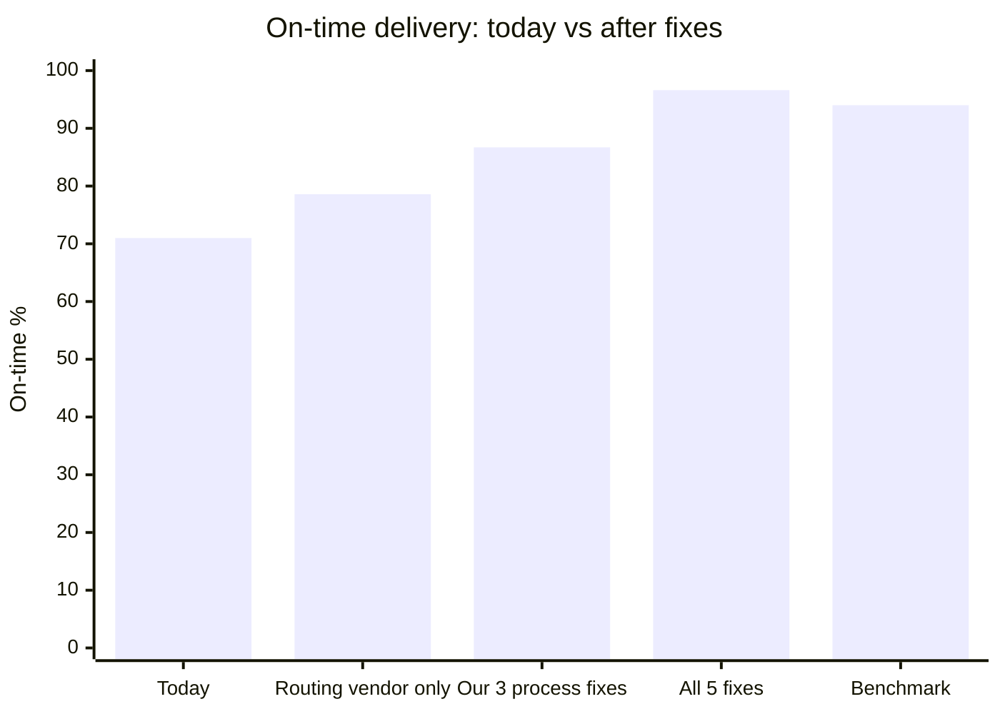
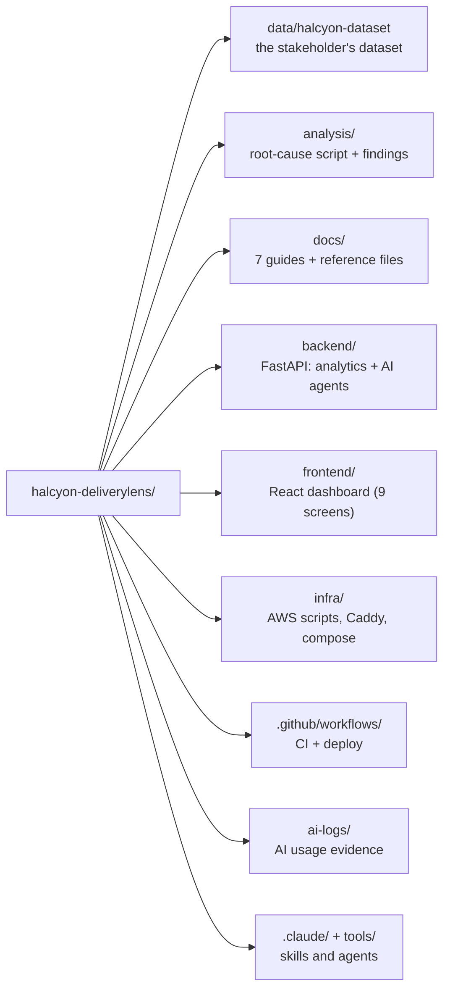

# Halcyon DeliveryLens

**EvoHack 2026 · Team InfinityStacks** (Sravan Kumar D · Sai M · Dinesh K) · Problem 2: late deliveries at Halcyon Logistics

> **In one line:** DeliveryLens finds *why* deliveries are late, *fixes* each cause with AI agents
> (Claude on Amazon Bedrock) and simple rules, and *proves* how much on-time delivery improves.

## The answer in one picture



**What this shows:** Halcyon's leaders were about to spend **$680K on routing software**. The
data shows routing explains only a small part of the lateness:

| Option | On-time delivery | Reaches the 94% benchmark? |
|---|---|---|
| Today | 71% | No |
| Buy the routing tool alone | about 79% | No |
| Fix the five causes we found (address capture, the same-day cutoff, stock placement, carrier choice by region, route deviation) | about 97% | Yes, and above it |

Details: [docs/03-what-the-data-says.md](docs/03-what-the-data-says.md).

## Read the documents in this order

| # | Document | What it covers |
|---|---|---|
| 1 | [What the judges want](docs/01-what-the-judges-want.md) | Deadlines, the pass/fail checklist, how the 100 points are split |
| 2 | [The problem](docs/02-the-problem.md) | Halcyon's story, how an order travels, what the stakeholder said, our questions |
| 3 | [What the data says](docs/03-what-the-data-says.md) | The five causes, carrier lanes, the 08:00 cutoff, money, data quality |
| 4 | [Solution and architecture](docs/04-solution-and-architecture.md) | What we build, the C4 diagrams, where each AWS service is used and when |
| 5 | [The plan to 29 Oct](docs/05-five-day-plan.md) | Gantt chart, who does what, day-by-day tasks |
| 6 | [AWS setup guide](docs/06-aws-setup-guide.md) | Step-by-step scripts for Monday; placeholders to fill |
| 7 | [How we work with AI agents](docs/07-how-we-work-with-ai-agents.md) | The agent pipeline across roles, and where the proof lives |

Word versions of every document are in [`docs/downloads/`](docs/downloads/).

## Repository map



**What this shows:** where everything lives.
- `data/`: the original data, unchanged.
- `analysis/`: how we found the causes.
- `backend/` and `frontend/`: the app.
- `infra/`: how it goes onto AWS.
- `docs/`: the explanations.
- `ai-logs/`: proof of how we used AI agents.

## Run it on a laptop

Python 3.11+, Node 20 and Docker are needed for the full stack. The app works without AWS:
the AI agents run in **mock mode** until Bedrock is connected.

```bash
# 1. Re-run the analysis (needs only pandas)
python analysis/root_cause_analysis.py

# 2. Backend
cd backend && python -m venv .venv && source .venv/bin/activate
pip install -r requirements.txt
python -m app.loader            # loads data/halcyon-dataset into the database
uvicorn app.main:app --reload   # http://localhost:8000/api/docs

# 3. Frontend (new terminal)
cd frontend && npm install && npm run dev   # http://localhost:5173
```

Or run everything at once with Docker: `docker compose up --build`, then open http://localhost:5173.

## AWS (from Monday 26 Oct)

Uses only the services the team requested: **Bedrock, IAM, S3, ECR, Secrets Manager, RDS
PostgreSQL, CloudWatch, Amplify, EC2**. See [docs/06-aws-setup-guide.md](docs/06-aws-setup-guide.md).

## Deliverables checklist (due 29 Oct)

- [x] Discovery questions asked; answers applied ([docs/02](docs/02-the-problem.md))
- [x] Agent pipeline across roles ([ai-logs/](ai-logs/INDEX.md))
- [x] AI inside the product (Order Intake, Delay Alert, Ask DeliveryLens agents)
- [x] Usable UI and working backend with tests
- [ ] Deployed on AWS (Monday 26 Oct, once access arrives)
- [ ] Evidence pack and final AI logs (Wed 28 Oct)
