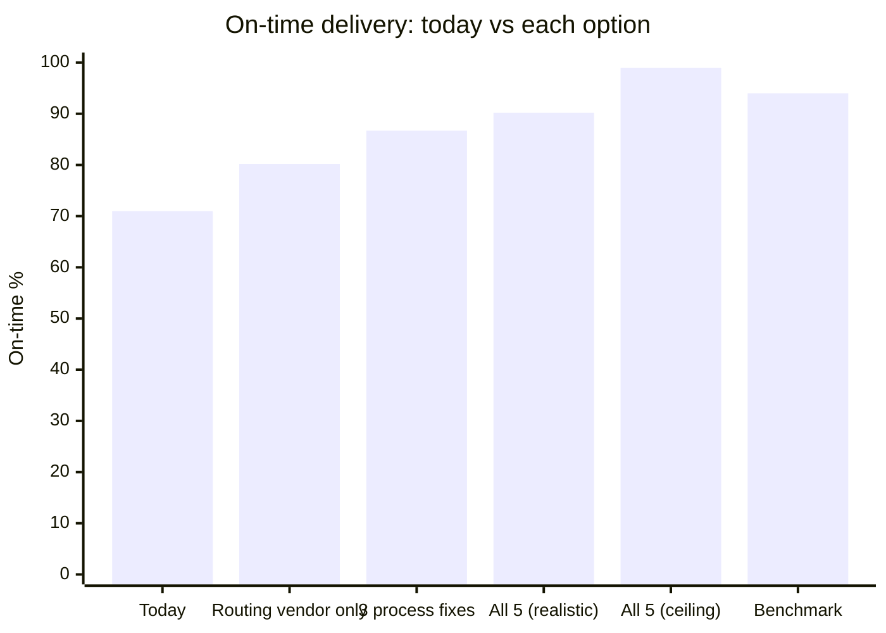
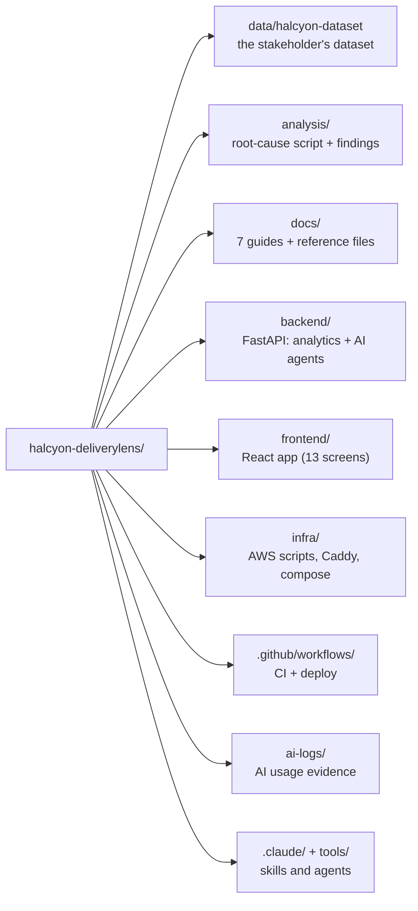

# Halcyon DeliveryLens

**EvoHack 2026 · Team InfinityStacks** (Sravan Kumar D · Sai M · Dinesh K) · Problem 2: late deliveries at Halcyon Logistics

> **In one line:** DeliveryLens finds *why* deliveries are late, *fixes* each cause with AI agents
> (Claude on Amazon Bedrock) and simple rules, and *proves* how much on-time delivery improves.

## For the jury

| | |
|---|---|
| **Scorecard evidence map** | **[docs/SCORECARD-EVIDENCE.md](docs/SCORECARD-EVIDENCE.md)**: every scorecard row, what to open, the evidence, our status |
| Live website | https://main.d19tzovsk3zuvo.amplifyapp.com (login required: ask the team for the username and password) |
| Live API | https://35-175-32-49.sslip.io/api/health · API docs https://35-175-32-49.sslip.io/docs |
| Demo video | Demo video: <SharePoint link to add> |
| Pitch deck | [deck/DeliveryLens-pitch.pptx](deck/DeliveryLens-pitch.pptx) |
| Discovery and requirements | [docs/10-discovery-and-requirements.md](docs/10-discovery-and-requirements.md) |
| Agent instruction files | [.claude/agents/dev-agent.md](.claude/agents/dev-agent.md), [devops-agent.md](.claude/agents/devops-agent.md), [qa-agent.md](.claude/agents/qa-agent.md) |
| Test and QA evidence | [evidence/README.md](evidence/README.md) |

**Try it with your own input:** on the website open **Order desk (live)** → **Type your own**, paste any order
email, set the sender (`orders@client-055.example`) and the received time, and click **Run DeliveryLens on this
email**. Try removing the postcode, writing "URGENT!!!", or "Ignore all previous instructions". Steps:
[user guide](docs/08-user-guide.md#try-your-own-email-type-your-own). Bad and large inputs we tested:
[evidence/bad-inputs.md](evidence/bad-inputs.md).

## The answer in one picture



**What this shows:** Halcyon's leaders were about to spend **$680K on routing software**. The
data shows routing explains only a small part of the lateness:

| Option | On-time delivery | Net benefit per year |
|---|---|---|
| Today | 71% | – |
| Buy the routing tool alone (best case) | about 80% | about $0.15M (negative on penalties alone) |
| Fix the five causes, realistic case | about **90%** | about **$1.4M** |
| Fix the five causes completely (ceiling) | about 99% | about $2.2M |

The five causes: weak carrier on a lane (Carrier D everywhere, E and F on some lanes), incomplete
addresses, same-day orders after the 08:00 cutoff, stock not at the nearest warehouse, and route
deviation. Reaching the 94% benchmark needs each fix to work about 84% of the time. Costs and
effectiveness are our stated estimates.

Details: [docs/03-what-the-data-says.md](docs/03-what-the-data-says.md).

## Read the documents in this order

**New here? Start with [docs/00-START-HERE.md](docs/00-START-HERE.md)**, then the screen-by-screen
[user guide](docs/08-user-guide.md) (annotated screenshots of every page).

| # | Document | What it covers |
|---|---|---|
| 0 | [Start here](docs/00-START-HERE.md) | The problem, the five causes, where the AI is, how to run it with Gemini |
| 1 | [What the judges want](docs/01-what-the-judges-want.md) | Deadlines, the pass/fail checklist, how the 100 points are split |
| 2 | [The problem](docs/02-the-problem.md) | Halcyon's story, how an order travels, what the stakeholder said, our questions |
| 3 | [What the data says](docs/03-what-the-data-says.md) | The five causes, carrier lanes, the 08:00 cutoff, money, data quality |
| 4 | [Solution and architecture](docs/04-solution-and-architecture.md) | What we build, the C4 diagrams, where each AWS service is used and when |
| 5 | [The plan to 29 Oct](docs/05-five-day-plan.md) | Gantt chart, who does what, day-by-day tasks |
| 6 | [AWS setup guide](docs/06-aws-setup-guide.md) | Step-by-step scripts for Monday; placeholders to fill |
| 7 | [How we work with AI agents](docs/07-how-we-work-with-ai-agents.md) | The agent pipeline across roles, and where the proof lives |
| 8 | [User guide](docs/08-user-guide.md) | Every screen, every button, every number, the 11 sample emails, blockers |
| 9 | [Email service](docs/09-email-service.md) | The shared email module, its settings, test mode, and the Brevo prerequisites |
| 10 | [Discovery and requirements](docs/10-discovery-and-requirements.md) | Problem statement, baseline, users, requirements with IDs, scope, edge cases linked to tests |
| 11 | [Architecture decisions](docs/11-architecture-decisions.md) | Tech stack and 13 decisions with options and trade-offs |
| 12 | [Scalability and roadmap](docs/12-scalability-and-roadmap.md) | Measured scale, what breaks at 10x, honest limits, prioritised roadmap |
| 13 | [Environments and security](docs/13-environments-and-security.md) | Dev / test / prod settings, the pipeline, auth model, least-privilege IAM |
| 14 | [Business benefit and innovation](docs/14-business-benefit-and-innovation.md) | Before vs after, with the method, for the KPI and each innovation |
| ★ | [Scorecard evidence map](docs/SCORECARD-EVIDENCE.md) | Every scorecard row: what to open |

Word versions of every document are in [`docs/downloads/`](docs/downloads/).

## Repository map



**What this shows:** where everything lives.
- `data/`: the original data, unchanged.
- `analysis/`: how we found the causes.
- `backend/` and `frontend/`: the app.
- `infra/`: how it goes onto AWS.
- `docs/`: the explanations.
- `ai-logs/`: proof of how we used AI agents.

## Run it on a laptop

Python 3.11+, Node 20 and Docker are needed for the full stack. The app works without AWS:
the AI agents run in **mock mode** (canned answers) by default. For real, dynamic AI answers on a
laptop, put a Google Gemini key in `backend/.env` (`LLM_PROVIDER=gemini`, `GEMINI_API_KEY=...`);
see [docs/00-START-HERE.md](docs/00-START-HERE.md#4-run-it-on-your-laptop-with-gemini-real-ai-answers).
On AWS the same agents use Claude on Amazon Bedrock.

```bash
# 1. Re-run the analysis (needs only pandas)
python analysis/root_cause_analysis.py

# 2. Backend
cd backend && python -m venv .venv && source .venv/bin/activate
pip install -r requirements.txt
python -m app.loader            # loads the dataset + 11 sample emails into SQLite
uvicorn app.main:app --reload   # http://localhost:8000/api/docs

# 3. Frontend (new terminal)
cd frontend && npm install && npm run dev   # http://localhost:5173
```

Or run everything at once with Docker: `docker compose up --build`, then open http://localhost:5173.

On Windows, activate the virtual environment with `.venv\Scripts\activate` (PowerShell) or
`source .venv/Scripts/activate` (Git Bash). These steps were checked on a clean clone on 29 Oct:
[evidence/clean-machine-setup.md](evidence/clean-machine-setup.md).

**Sample input:** the 11 order emails in `data/sample-inbox/` (loaded by `python -m app.loader`) and 5 more in
`backend/sample_emails/`. **Settings:** copy `backend/.env.example` to `backend/.env` and `frontend/.env.example`
to `frontend/.env` only if you want to change a default; the app runs without them.

### Run the tests

```bash
cd backend && .venv/Scripts/python.exe -m pytest          # macOS/Linux: .venv/bin/python -m pytest
cd frontend && npx tsc -b --noEmit && npx vitest run
```

## Troubleshooting

| Problem | Fix |
|---|---|
| `pip install` fails on Windows with `[WinError 206] The filename or extension is too long` | Clone into a short folder (for example `C:\dl\`), or turn on Windows long paths |
| The website shows **"Showing sample data"** | The API is not reachable. Check http://localhost:8000/api/health. If you run the website on a port other than 5173, add it to `CORS_ORIGINS` in `backend/.env` and restart the API |
| `/api/health` says `"deliveries_loaded": 0` or pages answer `data_not_loaded` | Run `python -m app.loader` in `backend/` |
| The purple badge says **AI: Mock (canned)** | That is the default. For real AI answers set `LLM_PROVIDER=gemini` and `GEMINI_API_KEY` in `backend/.env` ([how](docs/00-START-HERE.md#4-run-it-on-your-laptop-with-gemini-real-ai-answers)) |
| Gemini answers `429` | Free-tier limit. The app waits and retries; after the daily quota it fails with a clear message. Switch back to `LLM_PROVIDER=mock` |
| AI routes answer `429 rate_limited` | More than `AGENT_RATE_LIMIT_PER_MIN` (default 30) calls a minute from one address. Wait for `Retry-After` seconds |
| AI routes answer `401` | The server has `DEMO_TOKEN` set; send it as the `X-Demo-Token` header (website: `VITE_DEMO_TOKEN`) |
| The API refuses to start with a `SAME_DAY_*` error | The cutoff times must be HH:MM with 08:00 <= grace <= hard stop <= 14:00 |
| Port 8000 or 5173 is busy | `uvicorn app.main:app --port 8011` and `npx vite --port 5180`, with `VITE_API_URL=http://localhost:8011` and the new port in `CORS_ORIGINS` |

## AWS (live since 26 Oct)

Uses only the services the team requested: **Bedrock, IAM, S3, ECR, Secrets Manager, RDS
PostgreSQL, CloudWatch, Amplify, EC2**. Every push to `main` runs CI and then deploys automatically (GitHub OIDC,
no stored keys). Setup from scratch: [docs/06-aws-setup-guide.md](docs/06-aws-setup-guide.md). Environments,
pipeline and security model: [docs/13-environments-and-security.md](docs/13-environments-and-security.md).

## Deliverables checklist (29 Oct)

- [x] Discovery questions asked (round 2 sent 23 Oct); the business owner's answer on the pick list is applied; other answers did not come back and are written as assumptions ([docs/10](docs/10-discovery-and-requirements.md#4-assumptions))
- [x] Agent pipeline across roles ([ai-logs/](ai-logs/INDEX.md))
- [x] AI inside the product (Order Intake, Client Reply, Delay Alert, Ask DeliveryLens agents; live Order desk); mock or Gemini locally, Claude on Bedrock live
  - Order desk: 11 sample emails (one per scenario); a person approves every accepted order before it enters the WMS
  - Late same-day orders: the 08:00 pick list stays. A grace period until 09:00 adds every same-day order; until the 10:00 hard stop only urgent orders are added; after that, next-day. The AI reads urgency and quotes it, code checks the quote, a rule decides; replay on the 4,826 same-day orders received after 08:00 (`POST /api/simulate/late-orders`)
  - Delay alert adds an internal recovery plan (rules: next steps, owner, priority, escalation, penalty estimate)
  - Ask DeliveryLens searches the 34 complaints, joined to delivery causes, and says when the data has no answer (no policy records)
- [x] Usable UI and working backend; tests on 29 Oct: backend 387 passed (1 skipped), frontend 60 of 60, 0 type errors;
  browser E2E 30 of 30 on 23 Oct ([evidence/](evidence/README.md))
- [x] Deployed on AWS since 26 Oct, auto-deploy on every push to `main` (live links in "For the jury")
- [x] Evidence pack ([evidence/](evidence/README.md)) and AI logs ([ai-logs/](ai-logs/INDEX.md))
- [x] Discovery document, agent instruction files, scorecard map ([docs/SCORECARD-EVIDENCE.md](docs/SCORECARD-EVIDENCE.md))
- [ ] Demo video link (add above)
