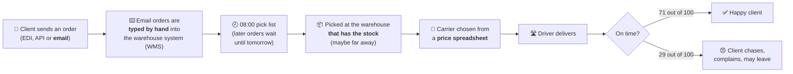
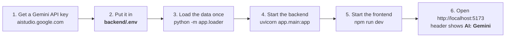
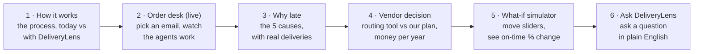

# Start here

If you read only one page, read this one. It explains, in plain words:
1. what problem the client has
2. what DeliveryLens does about it
3. where the AI agents are, and why
4. how to run it on your laptop, with a real AI (Google Gemini) giving the answers
5. which screen to open first

---

## 1. The client's problem, in one picture



**What this shows**
- Halcyon Logistics delivers goods for 280 business clients.
- Only **71 of every 100 deliveries arrive on time**. Good companies manage 94.
- Nine unhappy clients, worth **$14.2 million a year**, say they may leave.
- The bosses think the routes are the problem. They are about to buy **$680,000 of routing software**.
- Our job: find out what is really wrong, and fix it.

## 2. What the data told us: five problems, not one

We checked all 48,340 deliveries. Lateness comes from **five places** in the chain above:

| # | Problem | Where in the chain | Example | On-time points lost |
|---|---|---|---|---|
| 1 | Weak carrier on a lane | 🚚 Carrier choice | Carrier D is late in every region; Carrier F is late to the Southeast | 7.7 |
| 2 | Incomplete address | ⌨️ Order typed in | Email says "Savannah" but no street or postcode | 6.9 |
| 3 | Same-day order after 08:00 | 🕗 Pick list | Order at 09:30 promised "today", but the list was printed at 08:00 | 5.4 |
| 4 | Stock not at the nearest warehouse | 📦 Picking | Order for California ships from the Midwest | 4.9 |
| 5 | Driver goes far off the planned route | 🛣️ Delivery | Planned 150 km, drove 190 km | 3.1 |

The routing software can only fix #5, plus part of #1. That is why we advise **not to sign it as it stands**.

## 3. What DeliveryLens does, and where the AI is

```mermaid
flowchart TB
  subgraph IN["When an email order arrives"]
    E1["📧 Email lands in the<br/>order inbox"] --> G1["🛡️ Guardrail<br/>blocks tricks like<br/>'ignore your instructions'"]
    G1 --> A1["🤖 <b>Order Intake Agent (AI)</b><br/>reads the email like a person<br/>and pulls out: client, items,<br/>address, date"]
    A1 --> R1["📏 <b>Address check (rule)</b><br/>street, city, state, postcode<br/>all present?"]
    R1 -->|missing| H1["⏸️ Order put ON HOLD<br/>🤖 AI drafts a polite email<br/>asking for the missing part"]
    R1 -->|complete| R2["📏 <b>Promise check (rule)</b><br/>same-day after 08:00?<br/>→ promise next day instead"]
    R2 --> D1["🔎 <b>Stock check (data)</b><br/>nearest warehouse has it?<br/>if not, which one does?"]
    D1 --> R3["📏 <b>Carrier advisor (rule)</b><br/>best carrier for this region,<br/>not just the cheapest"]
    R3 --> W1["🏭 Order created in the<br/><b>WMS</b>, ready for the pick list<br/>🤖 AI drafts the confirmation"]
  end
  subgraph AFTER["After dispatch and for managers"]
    A2["🤖 <b>Delay Alert Agent (AI)</b><br/>warns the client <i>before</i><br/>they have to chase"]
    A3["🤖 <b>Ask DeliveryLens (AI)</b><br/>answers managers' questions<br/>with numbers from the data"]
  end
```



**What this shows**
- **AI agents (🤖)** do the language work: reading messy emails, and writing replies and
  explanations. That is what AI is good at.
- **Rules (📏) and data lookups (🔎)** do the checking and the maths. These must always give the
  same, explainable answer, so we don't let AI guess them.
- **Guardrails (🛡️)** stop misuse and keep personal data out of the logs.
- **A person approves** every message before it goes to a client.

**How the agents are built:** our own small Python "pipeline". Each step is a plain function,
and the AI steps call one shared AI client that can use **Mock** (canned, offline), **Google
Gemini** (for demos on your laptop) or **Amazon Bedrock / Claude** (on AWS). No heavy framework.
Every AI call is recorded, and you can see them on the "Agent activity" screen.

## 4. Run it on your laptop with Gemini (real AI answers)



**Where the key goes:** create the file `backend/.env` (copy `backend/.env.example`) and set:

```ini
LLM_PROVIDER=gemini
GEMINI_API_KEY=paste-your-key-here
GEMINI_MODEL=gemini-2.5-flash
```

- `backend/.env` is **never committed to git** (it is in `.gitignore`). Keep the key only there.
- Restart the backend after changing it. Check that it worked: open
  http://localhost:8000/api/health. It should say `"llm_provider": "gemini"` and
  `"llm_ready": true`.
- To go back to offline canned answers, set `LLM_PROVIDER=mock`.

The commands:

```bash
cd backend
python -m venv .venv && source .venv/bin/activate      # Windows: .venv\Scripts\activate
pip install -r requirements.txt
python -m app.loader                                    # loads the dataset + sample emails into SQLite
uvicorn app.main:app --reload --port 8000

# second terminal
cd frontend
npm install
npm run dev                                             # open http://localhost:5173
```

## 5. Which screen to open first



**What this shows:** the best order to explore the app (and to demo it). Every screen has a
**"What am I looking at?"** panel at the top that explains each number and button. For a full
tour with pictures, read [08-user-guide.md](08-user-guide.md).

## 6. What is real, and what is simulated

| Thing | Real or simulated? |
|---|---|
| 48,340 deliveries, clients, carriers, penalties, complaints | **Real hackathon dataset** from the stakeholder (synthetic data, but it is "their" data) |
| The 5 causes and all percentages | **Calculated from that data** by `analysis/root_cause_analysis.py` |
| The 12 emails in the Order desk | **Written by us** to show typical cases, good and bad, because the dataset has no email text |
| The warehouse system (WMS) | **A simple table in our database** that stands in for the client's WMS |
| AI answers | **Mock** (canned) by default; **Gemini** when you add a key; **Claude on Bedrock** on AWS |
| Costs in the business case | **Our estimates**, clearly labelled, for the client to confirm |
