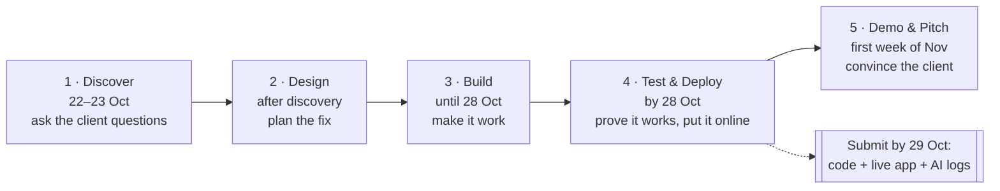
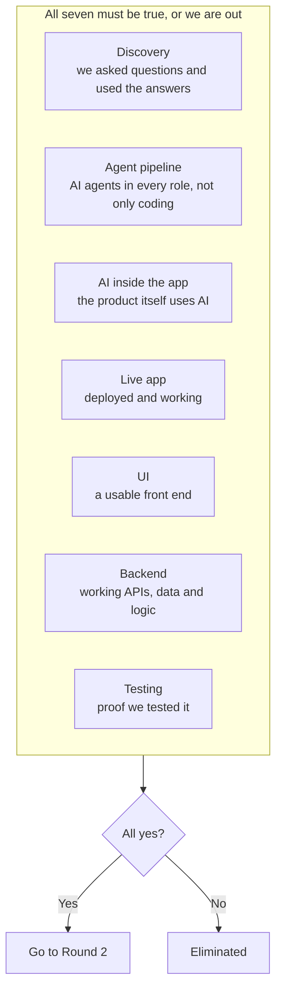
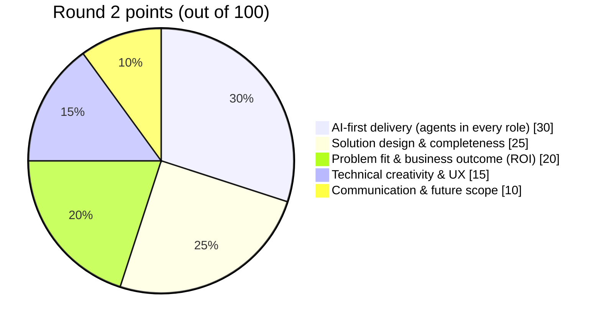
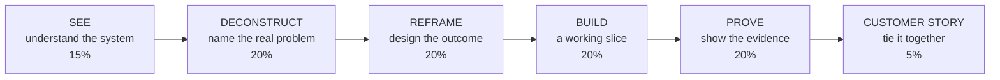
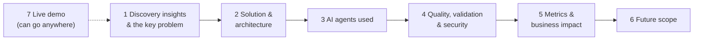

# 1. What the judges want

This page explains the hackathon rules in simple words, so the whole team aims at the same target.

## The journey, one picture

**What this shows**
- The hackathon has five steps, in order. You cannot skip one.
- The hard deadline is **29 October**. By then we must hand in three things:
  1. the code on GitHub
  2. a working app that is online
  3. logs showing how we used AI agents
- The presentation comes later, in the first week of November.

## Round 1: the pass/fail checklist

**What this shows**
- Round 1 is a checklist. Every box must be ticked.
- For example: if we build a beautiful app but it only runs on a laptop, "Live app" is missing,
  and we are out.
- We are also out if we:
  - miss the deadline
  - drift away from the problem
  - break the rules (for example by using real customer data)

## Round 2: how the 100 points are split

**What this shows**
- The biggest slice, 30 points, is about **how we used AI agents across the whole project**:
  business analysis, design, coding, testing, deployment, documentation.
  - Example: "The BA agent turned the stakeholder call into a list of assumptions. The test agent
    wrote and ran our browser tests." We must be able to show logs for this.
- 20 points are for thinking like a consultant:
  1. name the real problem
  2. propose the fix
  3. prove the return on investment
- **The judges play the client** (Halcyon's COO and CFO). We speak to them as a client, not as
  our managers.

## The "FDE lens": what good thinking looks like

**What this shows, using our problem as the example**
- **See:** we mapped how an order travels, from the client's email to the truck and the doorstep.
- **Deconstruct:** the data shows five different reasons for late deliveries, not one.
- **Reframe:** leadership asked for "a routing engine". We say "fix the five causes, starting with
  the three cheap ones".
- **Build:** DeliveryLens, a working app.
- **Prove:** on-time delivery goes from 71% toward 96.6% in the data, cause by cause.
- **Customer story:** "Here is why you were about to spend $680K on the wrong fix."

## The presentation (30 minutes)

**What this shows**
- 20 minutes of talk and demo, then 10 minutes of questions.
- These seven sections are compulsory, in this order. The live demo can sit anywhere.
- At least one team member must present.
