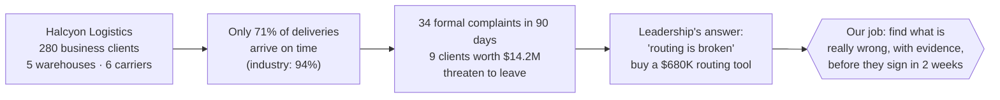
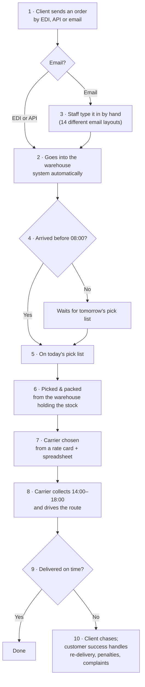
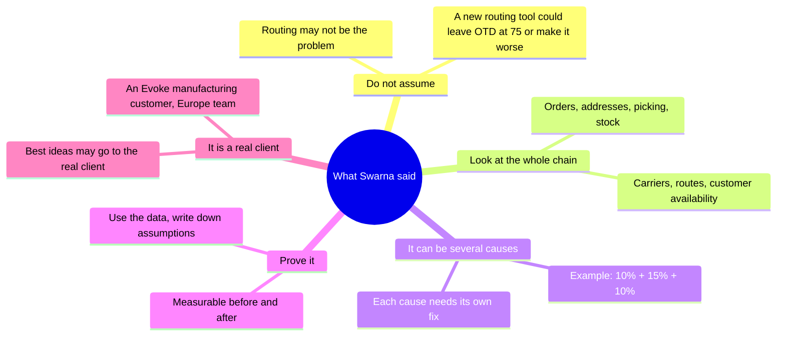

# 2. The problem: late deliveries at Halcyon Logistics

## The story in one picture

**What this shows**
- Halcyon moves goods for 280 business clients, using 5 warehouses and 6 trucking companies
  (carriers).
- Only 71 of every 100 deliveries arrive on time. Good companies manage 94.
- Clients are angry, and 9 of them, worth $14.2 million a year, say they may leave.
- The COO and CFO think the routes are the problem, and are about to sign a $680,000 contract
  for routing software.
- We are the advisers. We must say whether that is the right fix, and prove it.

## How an order travels today

**What this shows, step by step with examples**
1. A client orders, in one of three ways:
   - **EDI** (an automatic system-to-system feed)
   - **API**
   - **email**
2. EDI and API orders flow into the warehouse system on their own.
3. Email orders are typed in by hand. Example: Client 190 sends an email in its own layout, and a
   staff member copies the address and items into the system. That is easy to get wrong or
   incomplete.
4. Each warehouse prints its pick list at **08:00**. An order that arrives at 08:05 waits until
   the next day. For a **same-day** order, that almost guarantees it will be late.
5. Workers pick the goods from the shelves and pack them.
6. If the nearest warehouse has no stock, the order ships from a further one. Example: an order
   for the West ships from the Midwest, about 1,600 miles away.
7. Someone picks a carrier using a price list and a spreadsheet, so cheaper usually wins.
8. The carrier collects between 14:00 and 18:00 and drives the route.
9. If it arrives late, the client chases, and the customer success team spends time fixing it.

## What the stakeholder told us (Swarna, briefing call)

**What this shows**
- Swarna warned us not to accept "routing is broken" without proof.
- She expects more than one cause, each with its own fix, and wants numbers that prove the fix
  works.
- This is a real Evoke customer problem, so a strong answer may be shown to the real client.

## Our questions for the client (discovery)

We send questions through the L&D question log. Answers come back within 24 hours.
These are the questions that matter most now that we have the data:

| # | Question | Why we ask (example of how the answer changes our plan) |
|---|---|---|
| 1 | Is "on time" measured against the promised date, as in the data (`on_time` = delivered on or before `promised_date`)? | If they use a different date, every number changes |
| 2 | Why do 12% of orders arrive with an incomplete address, and 28% of email orders? Who fixes the address, and when? | This is our biggest cause. If nobody checks addresses before picking, our address-check agent is the fix |
| 3 | Can same-day orders that arrive after 08:00 still be accepted as same-day? Could there be a second pick wave? | Same-day orders after 08:00 are on time only 39% of the time |
| 4 | How is stock split between warehouses, and how often is it rebalanced? | 12% of orders ship from a further warehouse because the nearest had no stock |
| 5 | Carrier D is weak in every region, and Carrier F (the preferred supplier) to the Northeast and Southeast (about 55% on time when nothing else is wrong, vs about 99% for A, B, C). Can carriers be assigned per lane? Does the agreement require volumes? | Carrier choice by lane is worth 7.7 points with no new software |
| 6 | What exactly will the $680K routing tool change: routes only, or also carrier choice? | It tells us how much of the problem the vendor can fix |
| 7 | Every late delivery in the data has a $34 redelivery cost. Is that right, or a recording rule? | It affects the cost numbers we show the CFO |
| 8 | Three carriers have no API (D by portal, E and F by batch file). How quickly do their delivery updates arrive? | 12 of 34 complaints say "nobody told us it would be late" |

Our round-2 questions are in `docs/working/discovery-question-log-round2-InfinityStacks.xlsx`.
**Answers are pending** (due Monday 26 Oct). When they arrive we record them in the same file
and list what each answer changed in our assumptions.
