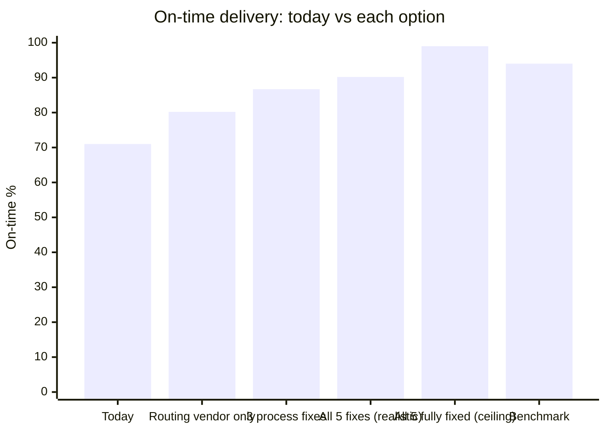
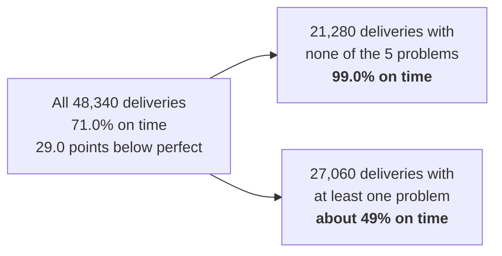
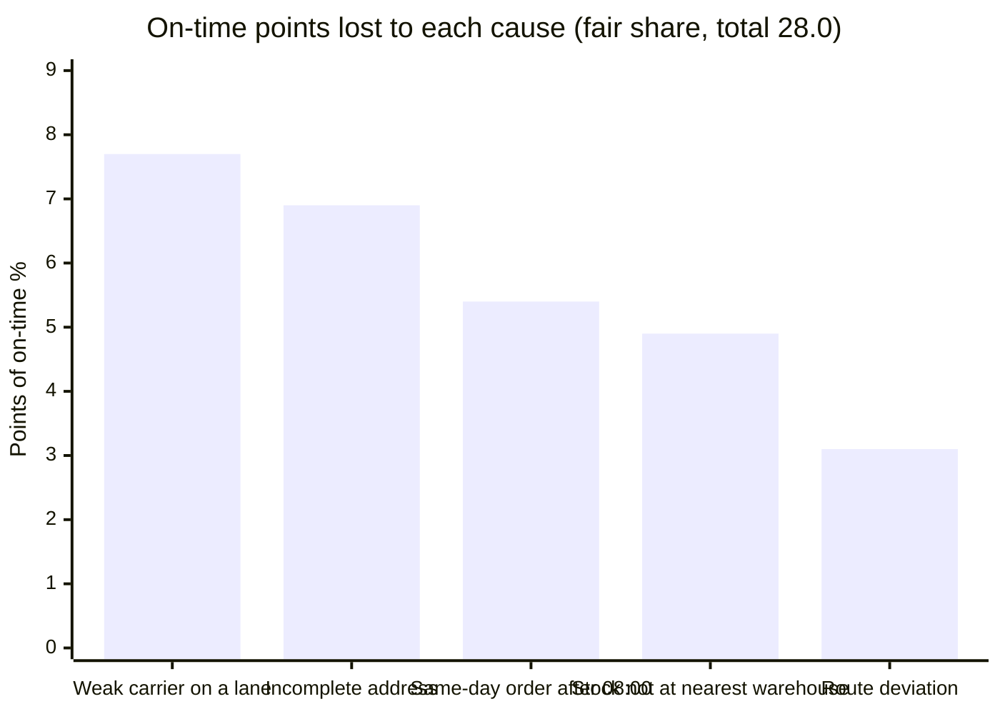
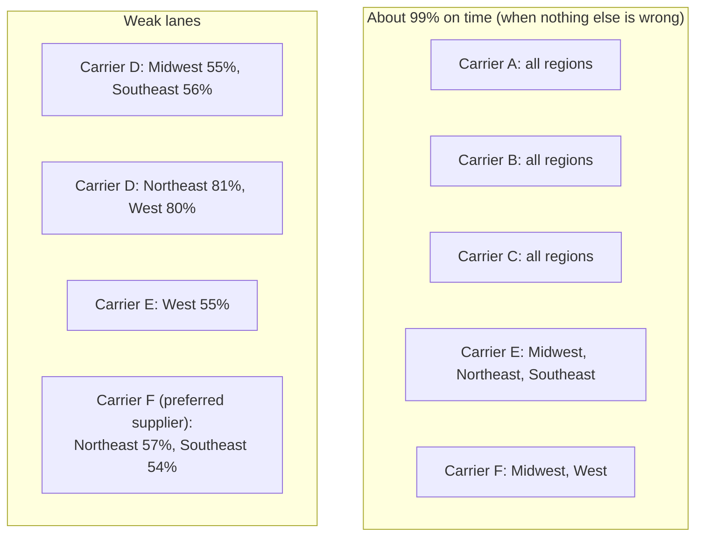
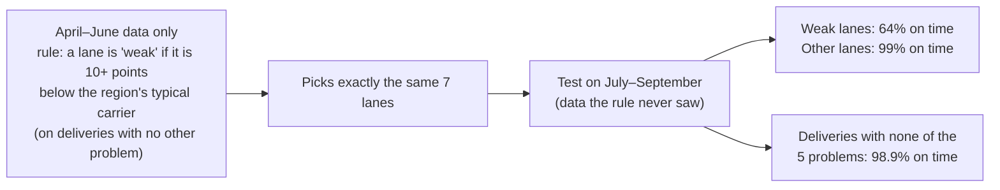
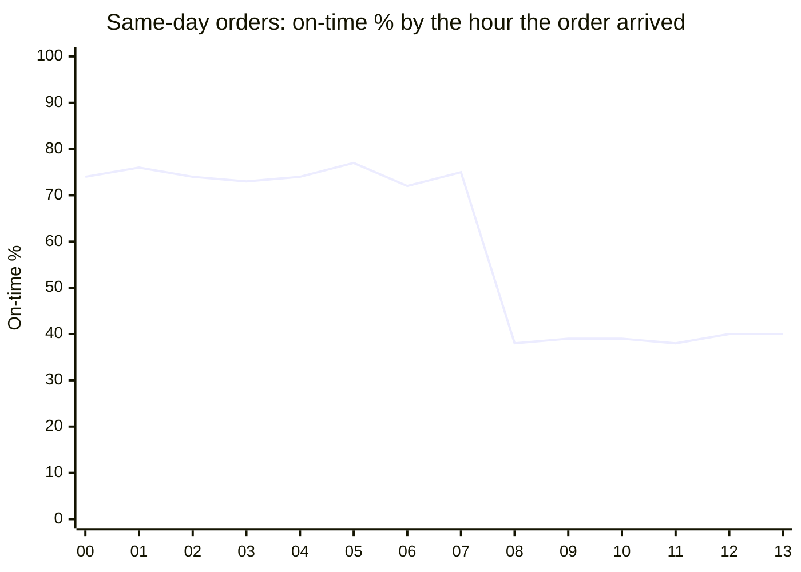
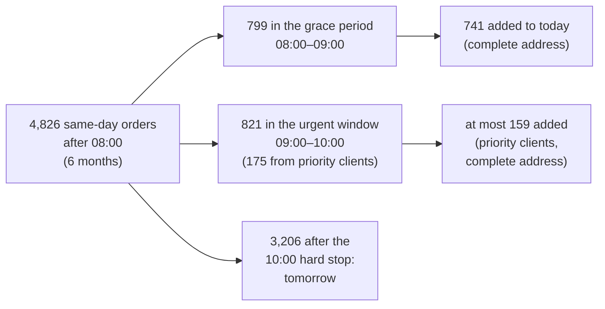
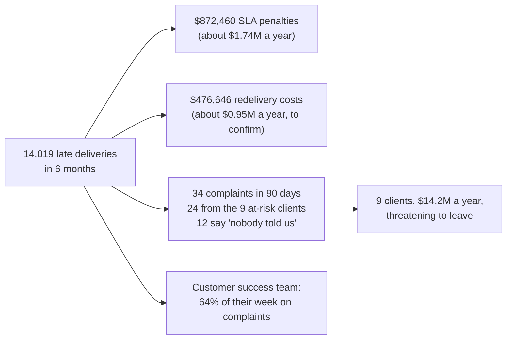
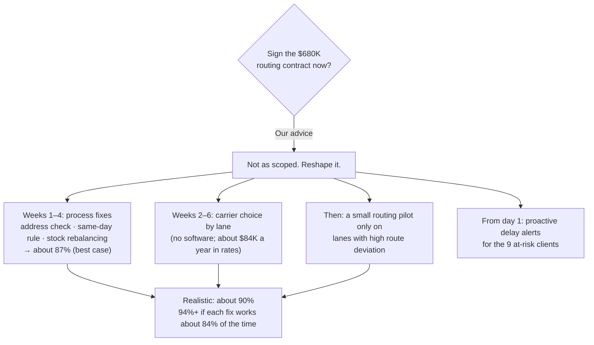

# 3. What the data says

We looked at all **48,340 deliveries** from 1 April to 25 September 2026. Every number below is
produced by `analysis/root_cause_analysis.py`; the results are in
`analysis/output/findings.json`. Anyone can re-run it and get the same numbers.

## The headline in one picture

**What this shows**
- **Today:** 71 of every 100 deliveries are on time.
- **Routing tool only:** at best about 80, even if it fixes everything routing can fix
  (carrier choice and route deviation).
- **Three process fixes:** about 87. These are address checks, the same-day cutoff and stock
  placement.
- **All five fixes, realistic case:** about **90**. This assumes each fix works most of the time,
  not always (see the assumptions below).
- **Ceiling:** if every cause were removed completely, about **99**. That is the upper limit, not
  a promise.
- **To pass the 94% benchmark,** each fix has to work about **84%** of the time.

## Proof that we found the real causes

**What this shows**
- Deliveries with none of the five problems are on time **99%** of the time. Halcyon's normal
  operation works; these five problems pull it down.
- The five causes explain **28.0 of the 29.0 on-time points** lost today. The last point is
  ordinary noise: even problem-free deliveries are occasionally late.

## The five causes

**What this shows:** how many on-time points each cause costs. "Fair share" means that when one
delivery has two problems, the blame is split between them, so nothing is counted twice.

| # | Cause | How many deliveries | On time when it happens | Example from the data | Can a routing tool fix it? |
|---|---|---|---|---|---|
| 1 | **Weak carrier on a lane**: Carrier D in every region, E to the West, F to the Northeast and Southeast | 12,624 (26%) | 59% | Carrier F, the "preferred supplier", is 54% on time to the Southeast. A, B and C are about 99% when nothing else is wrong | Partly: carrier selection, which needs no new software |
| 2 | **Incomplete address** when the order arrives | 5,994 (12%) | 35% | 28% of email orders have an incomplete address, against 5% of EDI/API orders | No |
| 3 | **Same-day order after 08:00**, when the pick list is already printed | 4,826 (10%) | 39% | A same-day order at 07:45 is on time 75% of the time; at 08:15 it drops to 38% | No |
| 4 | **Stock not at the nearest warehouse**, so it ships from far away | 6,009 (12%) | 50% | An order for the West ships from the Midwest, about 1,600 miles instead of about 160 | No |
| 5 | **Route deviation**: the driver went more than 20% beyond the planned route | 2,880 (6%) | 37% | Planned 150 km, drove 190 km | **Yes**, this is what routing tools fix |

## Carriers: Carrier D is weak everywhere; E and F on certain lanes

**What this shows**
- We compared carriers only on deliveries with **none of the other four problems**, so the
  comparison is fair.
- Most carrier–region pairs are about 99% on time.
- **Carrier D is weak in every region:** very weak in the Midwest and Southeast, and still about
  20 points behind in the Northeast and West.
- Carrier E is weak only to the West.
- Carrier F, the "preferred supplier", is weak to the Northeast and Southeast.
- The fix is simple: send those shipments with a strong carrier in that region.
  - **This needs no new software.** It is a change to the carrier preference spreadsheet.
- Switching costs a little more, about **$84K a year** in higher rates on these lanes, because
  the weak lanes are the cheap ones. That is far less than the penalties and redeliveries they
  cause.

## Did we just fit the data? A fair test

**What this shows**
- A fair worry: did we choose the weak lanes by looking at the answers?
- So we chose them using only the first three months, with a fixed rule, and tested them on the
  last three months.
- The same seven lanes came out, and they stayed weak on the months the rule never saw.
- The causes are stable over time, not a coincidence.
- See `holdout_check` in `findings.json`.

## The same-day cutoff

**What this shows**
- Same-day orders that arrive **before 08:00** are on time about 75% of the time.
- From 08:00 on, they fall to about 39%, because the pick list has already been printed.
- The business owner's answer: the procedure must not change. The 08:00 pick list stays, and there
  is no second pick wave.
- The fix keeps the 08:00 list and adds two simple time rules for same-day orders that miss it:
  1. **Grace period, 08:00 to 09:00:** every same-day order with a complete address is still added
     to today's pick list.
  2. **Urgent orders only, 09:00 to 10:00:** an order is added only if it is urgent.
  3. **Hard stop, from 10:00:** the order goes on tomorrow's list and is honestly re-promised as
     next-day.

### Late same-day orders: the grace period and the urgent window

The rule is in `backend/app/analytics/late_orders.py`. The Order desk uses it at step 6, and
`POST /api/simulate/late-orders` replays it on history.

**Who counts as urgent (09:00 to 10:00)**
- **A valid reason, any client.** The AI reads the email and quotes the sentence, for example "Our
  production line stops at 3pm without these parts." Code checks that the quote is a whole sentence
  of the email and shows operational impact (a stopped line, a fixed deadline, a store opening).
- **"Urgent" with no reason, priority clients only.** A priority client is Tier 1 (at least $1M
  revenue a year) or at risk of leaving. "URGENT!!!" from any other client goes to tomorrow.
- **Not urgent:** tomorrow, even for a priority client.
- The AI only reads the urgency and quotes the evidence. Code checks the quote; the rule decides.
- The two times are settings (`SAME_DAY_GRACE_UNTIL`, default 09:00; `SAME_DAY_HARD_STOP`, default
  10:00), so the client can choose other times.

**How the replay works**
1. Take the 4,826 same-day orders received after 08:00.
2. Orders with an incomplete address are on hold and never added (106 in the first two windows).
3. An order added to today's list loses the "same-day after 08:00" cause. It then gets the on-time
   rate of deliveries with its other causes (the same method as the What-if simulator).
4. SLA money = that gain × the client's past SLA penalty per late delivery.
5. Six months of data × 2 = a year.

| Per year (defaults 09:00 and 10:00) | Grace period (exact) | Urgent window, priority clients (upper bound) |
|---|---|---|
| Orders added (6 months) | 741 | at most 159 |
| Extra orders per warehouse per day | 0.83 | at most 0.18 |
| Late deliveries avoided | **729** | up to 166 |
| SLA penalties avoided | **$43,436** | up to $16,927 |
| Late deliveries avoided for the 9 at-risk clients | 159 | up to 138 |

**What this shows**
- The grace period alone lifts these orders from **39% to 47% on time**, with less than one extra
  order per warehouse a day.
- The urgent window adds at most one more point (**48%** at most).
- Most late same-day orders (3,206 of 4,826) arrive after 10:00. They still go to tomorrow, but the
  client is told the next-day date at order time instead of finding out when the order is late.

**Limits (please challenge them)**
- These are model estimates, like the What-if simulator, not measured results.
- History has no email text. So the urgent window is an upper bound: it counts every priority-client
  order as if it said it was urgent. The other 614 orders from ordinary clients in that window would
  need a valid reason, which history cannot show, so they are not counted.
- The replay does not change the business case below, which already assumes the same-day fix works
  70% of the time.

## Money and people

**What this shows**
- Late deliveries cost about $1.74M a year in penalties.
- Redeliveries may cost about $0.95M more. We are checking this with the client: every late
  delivery shows exactly $34, which may be a recording rule.
- **Why the 9 clients are leaving:** their deliveries are no later than anyone else's (70.7% vs
  71.1% on time). What sets them apart is **complaints**: 24 of the 34 come from them, and many
  say "nobody told us it would be late".
  - Telling clients early (our Delay Alert agent) is the fastest way to keep them, even before
    on-time delivery improves.
- **What the complaints say, and what they don't:** 33 of the 34 complaints link to a delivery with
  at least one of the five causes; the most common is a weak carrier lane (12 of 33). 26 of 34 were
  escalated to the account owner.
  - A complaint's category is the reason the client gave, not a checked cause.
  - The data has **no policy or resolution records** (no refund or credit rules, no record of how a
    complaint was closed). Ask DeliveryLens says so instead of guessing.

## The business case: what each option buys (per year)

| Option | On-time | Penalties avoided | Redeliveries avoided | Cost per year (estimate) | Net benefit | Net, penalties only (cautious) |
|---|---|---|---|---|---|---|
| Routing vendor only (best case) | 80.2% | $520K | $314K | $680K (vendor budget) | $154K | **−$160K** |
| 3 process fixes (best case) | 86.7% | $993K | $516K | $175K | $1.33M | $818K |
| **All 5 fixes, realistic** | **90.2%** | **$1.17M** | **$633K** | **$359K** | **$1.44M** | **$806K** |
| All 5 fixes, ceiling | 99.0% | $1.69M | $920K | $359K | $2.25M | $1.33M |

**What this shows**
- Even on the cautious view (penalties only, ignoring redelivery costs), the routing vendor
  **does not pay for itself in year one**.
- Our realistic plan gives about **$0.8M–$1.4M a year net**, before counting the $14.2M of
  revenue at risk.

**Our assumptions (please challenge them):**

| Fix | Assumed effectiveness (realistic case) | Assumed cost per year |
|---|---|---|
| Order Intake Agent (addresses) | 80% of gaps caught | $60K (build + Bedrock + support) |
| Same-day: grace period, urgent orders, honest next-day promise | 70% | $65K (staff time at 5 warehouses; estimate made for the earlier second-pick-wave idea, to re-check) |
| Monthly stock rebalancing | 50% | $50K (extra transfers) |
| Carrier choice by lane | 90% | $84K (higher rates; calculated from the rate card) |
| Route discipline / small routing pilot | 50% | $100K |

## Data quality notes (what we checked, what we assumed)

| What we found | What we did |
|---|---|
| 1,339 deliveries have no `actual_route_km` | Treated as "no route deviation". Those deliveries are 75% on time |
| 21 order IDs appear twice, for different clients | Kept them: `delivery_id` is unique. Asked the client |
| Every late delivery has a $34 redelivery cost, and no on-time one does | Looks like a recording rule. Asked the client; we show "penalties only" figures too |
| The 14 email layouts all perform about the same (69–73%) | The layout is not the problem; missing address fields are |
| `days_late` and `on_time` always agree with the dates | No fixes needed |

## What this means for the advice to leadership

**What this shows:** we don't say "never buy routing software". We say:
1. Fix the cheaper causes first.
2. Choose carriers by lane.
3. Tell at-risk clients about delays now.
4. Only then test routing software, where routes are really the problem.

Each step is measured, so leadership can see the number move before spending more.
