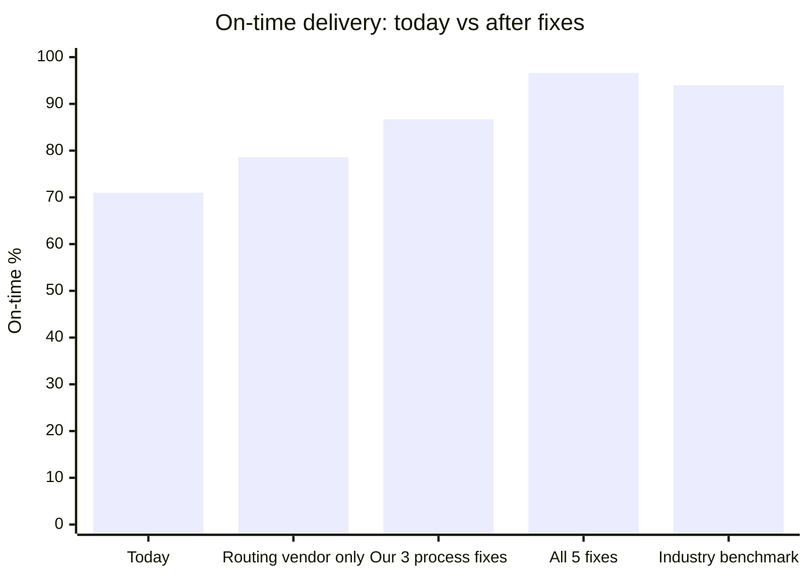
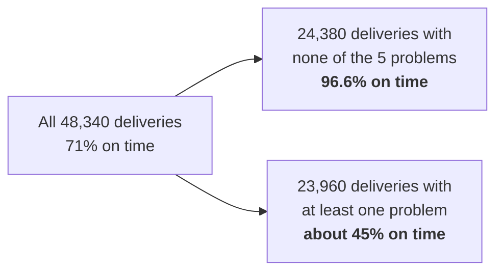
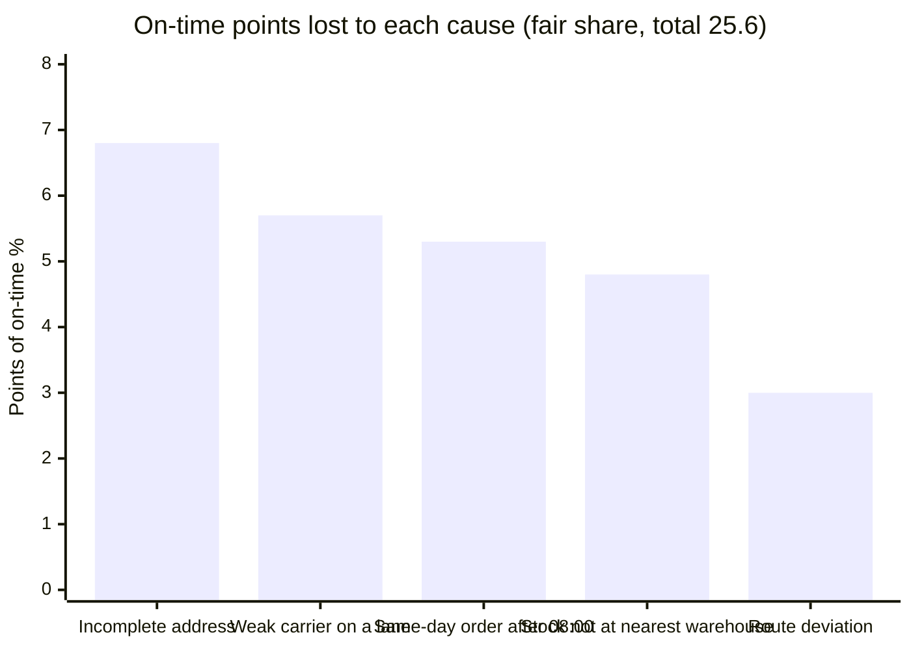
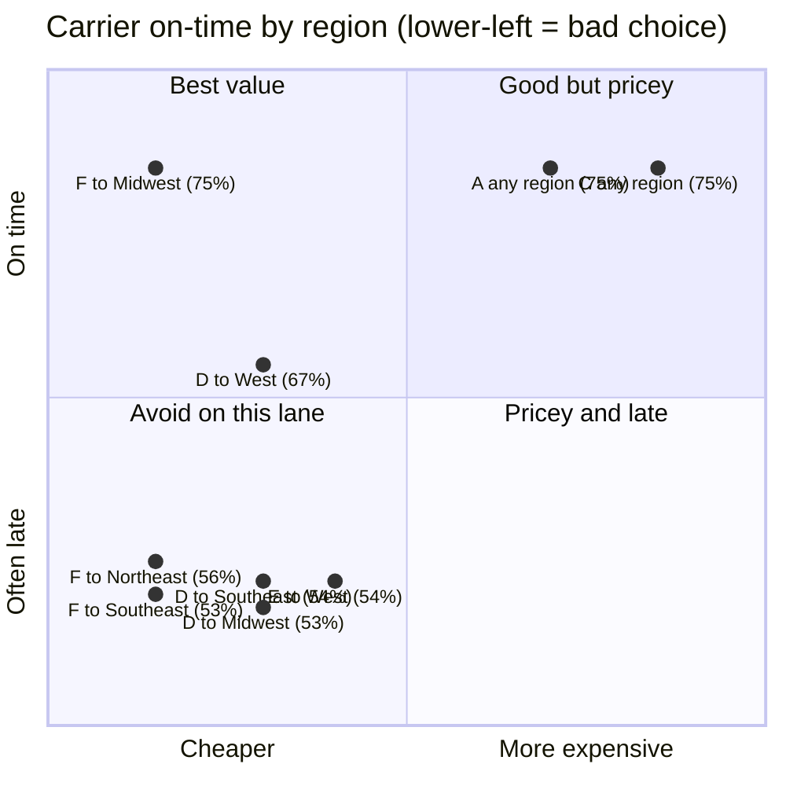
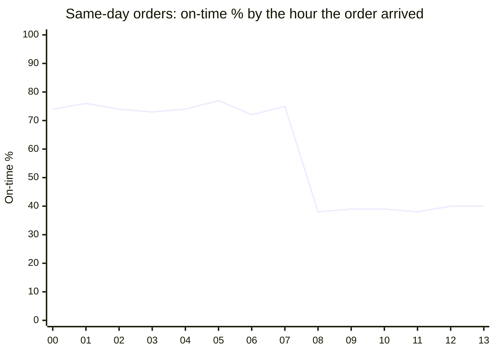
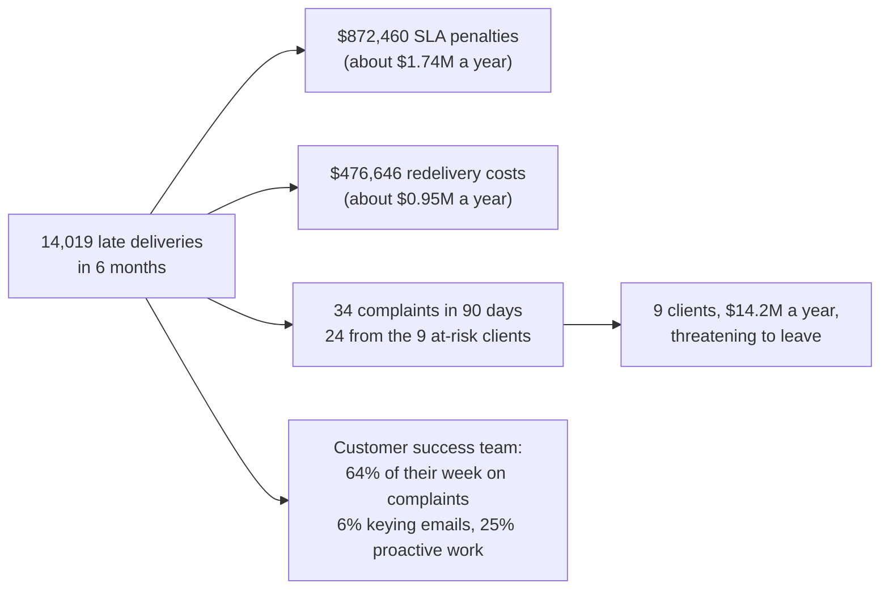
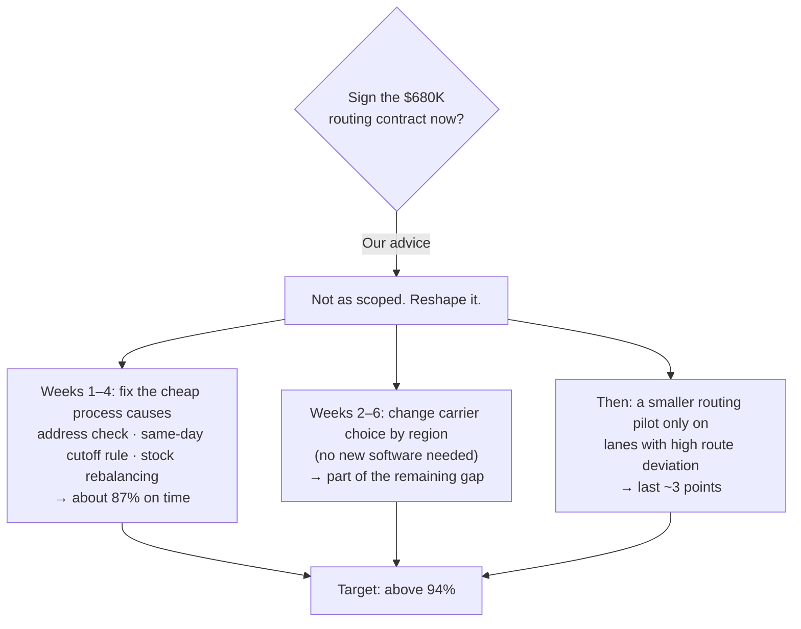

# 3. What the data says

We looked at all **48,340 deliveries** from 1 April to 25 September 2026. Every number below is
produced by `analysis/root_cause_analysis.py`; the results are in
`analysis/output/findings.json`. Anyone can re-run it and get the same numbers.

## The headline in one picture

**What this shows**
- **Today:** 71 of every 100 deliveries are on time.
- **If Halcyon only buys the routing tool:** at best about 79 in 100. It still misses the 94% benchmark.
- **If Halcyon fixes the three process problems** (addresses, the same-day cutoff, stock placement): about 87.
- **If all five causes are fixed:** about 97, better than the industry benchmark.
- Put simply: the routing tool fixes about a third of the problem. Most of the lateness
  starts before a truck ever leaves.

## Proof that we found the real causes

**What this shows**
- We split deliveries into two groups: those with none of the five problems, and those with at
  least one.
- Deliveries with none of the five problems are on time **96.6%** of the time, already above
  the 94% benchmark.
- Halcyon's normal operation works well; these five problems pull it down.
- Only 821 of the 14,019 late deliveries have none of the five problems. We explain about 94% of
  late deliveries.

## The five causes

**What this shows:** how many on-time points each cause costs. The five add up from 71% to 96.6%.
"Fair share" means that when one delivery has two problems, the blame is split between them.

| # | Cause | How many deliveries | On time when it happens | Example from the data | Can a routing tool fix it? |
|---|---|---|---|---|---|
| 1 | **Incomplete address** when the order arrives | 5,994 (12%) | 35% | 28% of email orders have an incomplete address, against 5% of EDI/API orders. Staff typing emails miss fields | No |
| 2 | **Weak carrier on a lane**: a carrier that is bad in one region | 7,895 (16%) | 54% | Carrier F, the "preferred supplier", is 53% on time to the Southeast while Carriers A, B and C are 74–76% | Partly (carrier selection) |
| 3 | **Same-day order after 08:00**: the pick list is already printed | 4,826 (10%) | 39% | A same-day order at 07:45 is on time 75% of the time; at 08:15 it drops to 38% | No |
| 4 | **Stock not at the nearest warehouse**, so it ships from far away | 6,009 (12%) | 50% | An order for the West ships from the Midwest, about 1,600 miles instead of about 160 | No |
| 5 | **Route deviation**: the driver went more than 20% beyond the planned route | 2,880 (6%) | 37% | Planned 150 km, drove 190 km | **Yes**, this is what routing tools fix |

## Carriers: the problem is the region, not the company

**What this shows**
- No carrier is bad everywhere. Each weak carrier is bad in **one or two regions**.
  - Carrier F is fine to the Midwest (75%) but poor to the Southeast (53%).
- The fix is simple: **do not send Carrier F to the Southeast; use Carrier A or B there**.
- Weak lanes are cheaper (about $13.04 vs $15.70 per shipment), which is why the spreadsheet
  picks them. Saving about $2.66 per shipment costs penalties and redeliveries far larger than
  that saving.

## The same-day cutoff

**What this shows**
- Same-day orders that arrive **before 08:00** are on time about 75% of the time.
- From 08:00 on, they fall off a cliff to about 39%.
- The reason: the pick list is printed at 08:00, so a same-day order at 08:30 waits for
  tomorrow's list but is still promised for today.
- The fix:
  1. stop promising "same day" after 08:00, or
  2. add a second pick wave (for example at 11:00).

## Money and people

**What this shows**
- **Late deliveries cost about $2.7M a year** in penalties and redeliveries. The routing tool
  costs $680K.
- **Customer success is stuck firefighting.** In the study week, 18 people spent 461 of 720
  hours on complaints.
- **12 of the 34 complaints say "nobody told us it would be late".** Even when a delay can't be
  avoided, telling the client early would stop many complaints.
- The 9 at-risk clients see the same problems as everyone else (71% on time). Three of them
  (C055, C190, C263) order by email, and **about a quarter of their orders arrive with an
  incomplete address**.

## Data quality notes (what we checked, what we assumed)

| What we found | What we did |
|---|---|
| 1,339 deliveries have no `actual_route_km` | Treated as "no route deviation". Those deliveries are 75% on time, so it doesn't change the picture |
| 21 order IDs appear twice, for different clients | Kept them: `delivery_id` is unique. Flagged as a question for the client |
| Every late delivery has a $34 redelivery cost, and no on-time one does | Looks like a recording rule. Asked the client (question 7) |
| `email_format_id` is blank for EDI/API | Expected; only email orders have a layout |
| The 14 email layouts all perform about the same (69–73%) | The layout itself is not the problem; missing address fields are |
| `days_late` and `on_time` always agree with the dates | No fixes needed |

## What this means for the advice to leadership

**What this shows:** we don't say "never buy routing software". We say:
1. Fix the cheaper causes first; they are about two-thirds of the problem.
2. Choose carriers by region.
3. Then test routing software only where routes are actually the problem.

That protects the $14.2M at risk without spending $680K on the smallest cause.
