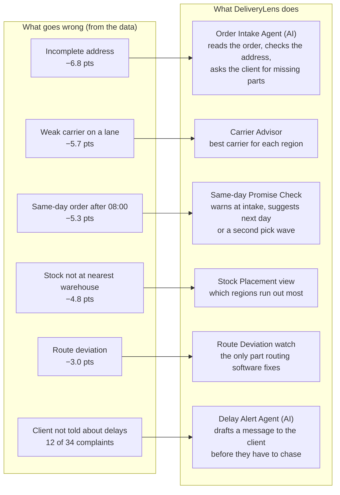
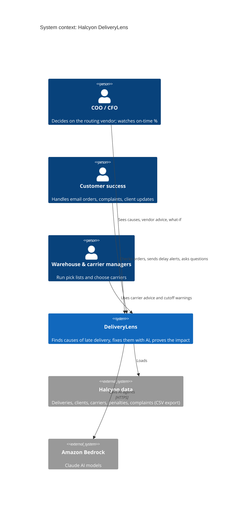
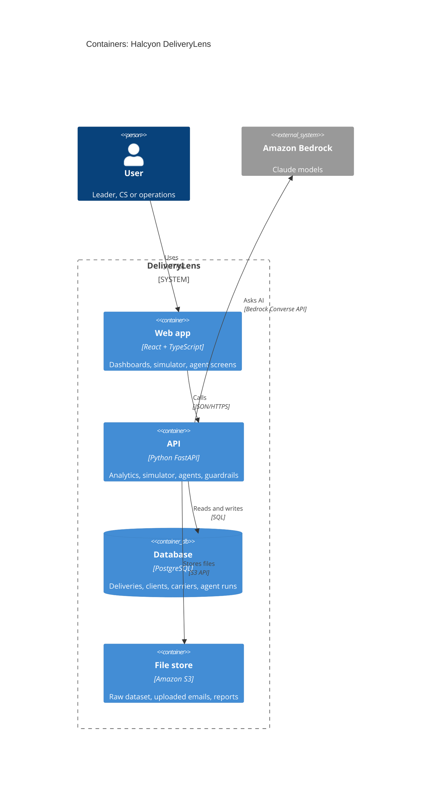
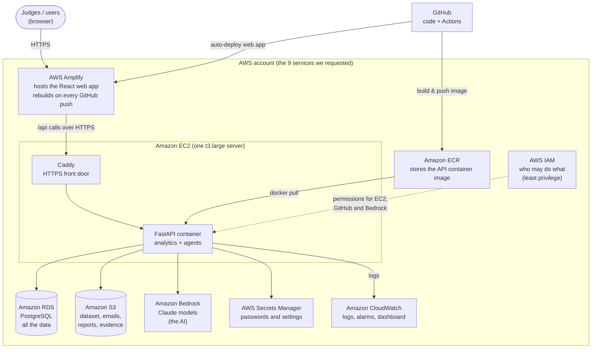
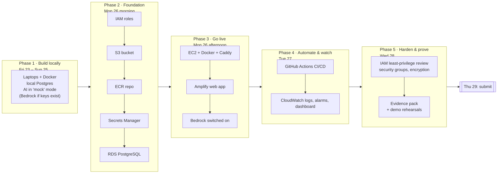
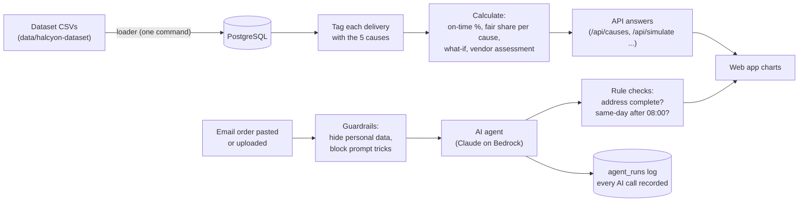
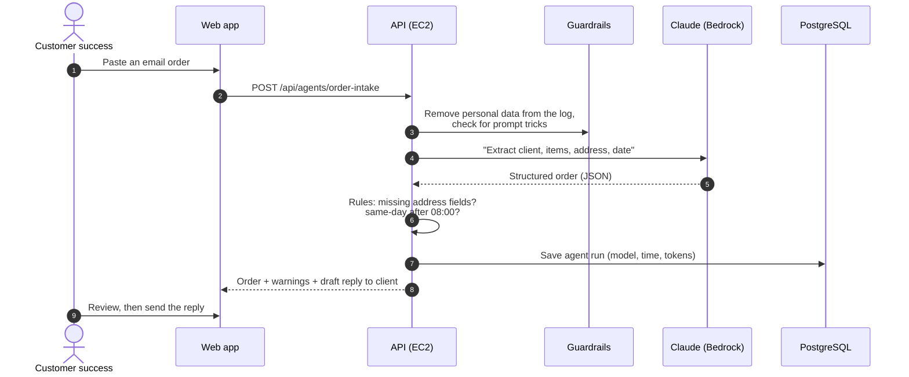
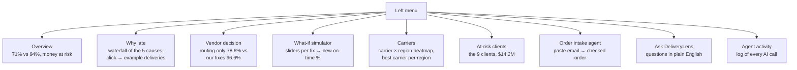
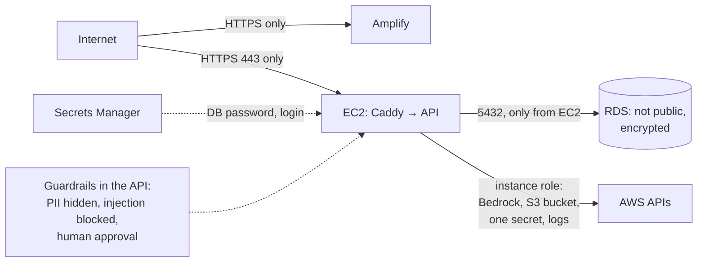

# 4. Our solution and its architecture

**DeliveryLens** is a web app for Halcyon's leaders and teams. It:
1. shows **why** deliveries are late
2. **fixes** the causes with AI agents and simple rules
3. **proves** how much on-time delivery improves

Every diagram below is followed by a plain-English explanation.

---

## 4.1 What DeliveryLens does: one cause, one fix

**What this shows:** every cause found in the data has its own fix, matching Swarna's
"different steps need different solutions".
- Example: an email order arrives without a postcode.
  1. The **Order Intake Agent** reads the email and spots the missing postcode.
  2. It drafts a short reply asking the client for it, before the order reaches the pick list.
  3. Today, that order would be on time only 35% of the time.

## 4.2 Who uses it (system context)

**What this shows**
- Three groups of people use DeliveryLens:
  - **leaders** look at the big picture and the vendor decision
  - **customer success** uses the AI agents every day
  - **operations** follow the carrier and cutoff advice
- DeliveryLens reads Halcyon's data and calls Claude through Amazon Bedrock.

## 4.3 The parts of the system (containers)

**What this shows:** the system has four parts.
- **Web app:** what people click on.
- **API:** the brain. It does the maths and runs the AI agents.
- **Database:** where the 48,340 deliveries and every AI call are stored.
- **File store:** keeps the original files.

The API is the only part that talks to the AI.

## 4.4 Where each AWS service is used

**What this shows, one service at a time**

| AWS service | Job in DeliveryLens | Example |
|---|---|---|
| **Amplify** | Hosts the website | The judges open `https://main.<id>.amplifyapp.com` |
| **EC2** | Runs our API in a Docker container | One server; Caddy adds HTTPS |
| **ECR** | Keeps the API container image | GitHub builds the image, EC2 pulls it |
| **RDS (PostgreSQL)** | Stores the data and the AI logs | 48,340 deliveries, 280 clients, every agent run |
| **S3** | Stores files | The original dataset, uploaded emails, generated reports |
| **Bedrock** | The AI | Claude reads an email order and finds the missing postcode |
| **Secrets Manager** | Keeps passwords out of the code | Database password, demo login |
| **CloudWatch** | Watches the app | Error logs, an alarm if the API stops |
| **IAM** | Controls access | The EC2 server may call Bedrock but cannot delete S3 data |

## 4.5 When each AWS service comes in (phases)

**What this shows**
- We build and test everything on laptops first; AWS arrives Monday 26.
- On Monday we create the basic AWS pieces (IAM, S3, ECR, Secrets Manager, RDS), then put the app
  online (EC2, Amplify, Bedrock).
- Tuesday adds automatic deployment and monitoring; Wednesday is for security and proof.
- Example: on Monday afternoon we switch the setting `LLM_PROVIDER=mock` to `bedrock`, and the
  same Order Intake Agent starts using real Claude.

## 4.6 How a request flows (data flow)

**What this shows**
- **Top row, the numbers:** we load the CSVs, tag each delivery with its causes, and calculate
  the results. The maths is plain Python, so the same data always gives the same number.
- **Bottom row, the AI:** text such as an email order passes through guardrails, then to Claude.
  The answer is checked by simple rules, and every AI call is recorded.
- Example: Claude extracts "ship to: 12 Harbor Rd, Savannah" and a rule notices the postcode is
  missing, so the order is flagged "incomplete address" before it is picked.

## 4.7 The AI agents inside the product

**What this shows:** the life of one AI call, using the Order Intake Agent as the example. AI
does the reading; simple rules do the checking; a person approves before anything goes to a client.

| Agent | What it does | Example |
|---|---|---|
| **Order Intake Agent** | Reads an email order, finds missing address parts, flags same-day-after-08:00 | "Postcode missing. Draft: 'Please confirm the postcode for order ORD-1234.'" |
| **Delay Alert Agent** | Writes a message to the client before they chase | "Your order D012345 will arrive 1 day late because the nearest warehouse ran out; it ships from W2 today." |
| **Ask DeliveryLens** | Answers leaders' questions with numbers from our analysis | "Which carrier is worst in the Southeast?" → "Carrier F, 53% on time (A is 75%)." |

**Safety rules for all agents:**
- AI never calculates the KPIs; the code does.
- Personal data is hidden in the logs, and prompt-injection attempts are blocked.
- A person approves every message before it goes out.
- Every call is logged.

## 4.8 The screens

**What this shows:** the nine screens.
- **Leaders** mostly use the first four: overview, why late, vendor decision, simulator.
- **Teams** use carriers, at-risk clients, order intake and ask.
- **Agent activity** is our evidence for the judges.

## 4.9 Security in one picture

**What this shows**
- Only HTTPS is open to the internet.
- The database can't be reached from outside; only our server can talk to it.
- The server has exactly the AWS permissions it needs and no more.
- Passwords live in Secrets Manager, not in the code.
- The AI has guardrails, and a person approves every client message.
- We use only the synthetic hackathon data, no real personal data.

## 4.10 Main design choices (and why)

| Choice | Why, in one line |
|---|---|
| One EC2 server running Docker | It is one of the services we requested, and it runs the same way on a laptop and in AWS |
| Amplify for the website | Requested; free HTTPS; deploys itself from GitHub |
| PostgreSQL on RDS | 48k rows is small; SQL is enough; requested |
| Maths in plain Python, AI only for reading and writing text | Numbers are always correct and repeatable; the AI cannot invent a KPI |
| Claude through Bedrock | Data stays in AWS; no API keys; requested |
| "Mock" AI mode | The app works and tests pass even before Bedrock access arrives |
| Caddy for HTTPS on EC2 | Browsers block an HTTPS page from calling a plain HTTP API; Caddy fixes this with no domain needed (`<ip>.sslip.io`) |
