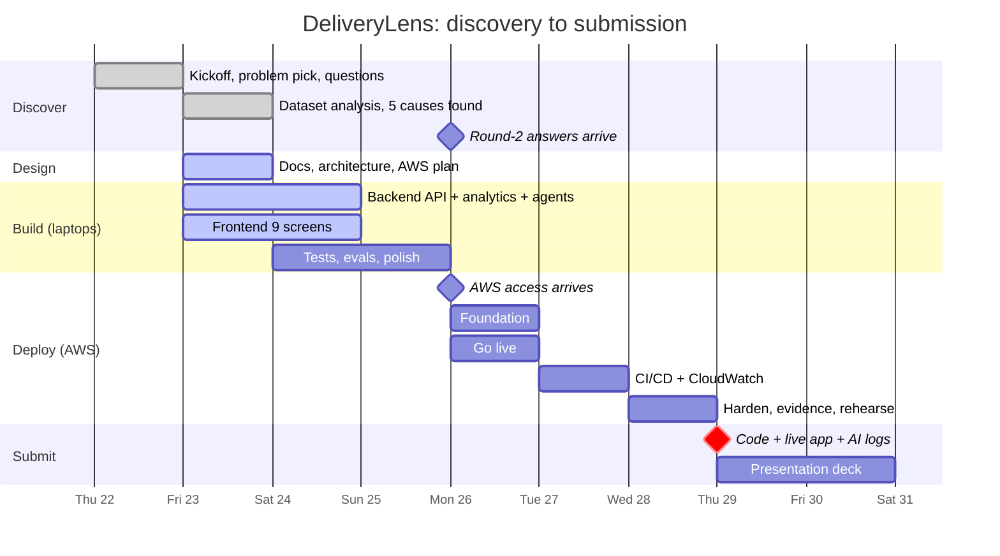
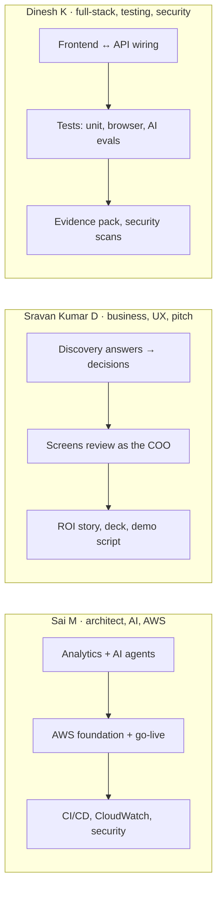

# 5. The plan to 29 October

**Deadline: Thursday 29 October, end of day.** By then: code on GitHub, the app live on AWS, and
the AI usage logs. The presentation deck follows straight after, for the first week of November.

## The plan on one page

**What this shows**
- **Discovery:** done. We picked the problem, asked questions and analysed the dataset.
- **Fri 23 to Sun 25:** build and test the whole app on laptops. The AI runs in "mock" mode
  until Bedrock is ready.
- **Mon 26 to Wed 28:** deploy on AWS, in your planned three deployment days.
- **Thu 29:** submit. Then finish the deck.

## Who does what

**What this shows:** a suggested split; swap freely. Each person also does some work outside
their main role (role convergence counts in the score), and **AI agents help in every role**
(see `07-how-we-work-with-ai-agents.md`).

## Day by day

### Fri 23 Oct (today): data, design, start building
| Done / doing | Output |
|---|---|
| Analyse the dataset; find the 5 causes | `analysis/`, `docs/03-what-the-data-says.md` ✅ |
| Write plain-English docs and architecture | `docs/01`–`07` |
| Build backend (API, analytics, agents in mock mode) | `backend/` + tests |
| Build frontend (9 screens) | `frontend/` + tests |
| Write AWS deploy scripts with placeholders | `infra/` |
| CI on GitHub Actions (tests on every push) | `.github/workflows/` |

**End of day check:** the app runs on a laptop with one command (`docker compose up`); tests pass.

### Sat 24 Oct: finish and polish the build
| Task | Who (+ AI agent) |
|---|---|
| Review every screen as the COO; list fixes | Sravan + UX researcher agent |
| Fix the list; improve charts | Dinesh + frontend developer agent |
| AI evals: order-intake accuracy on sample emails | Sai + test automation agent |
| Browser tests for the main flows | Dinesh + test automation agent |

**End of day check:** all main flows work end to end locally; no failing tests.

### Sun 25 Oct: tests, security, rehearse locally
| Task | Who (+ AI agent) |
|---|---|
| Security scan (dependencies, code) and fixes | Dinesh + AppSec agent |
| Dry-run the deploy scripts against a local Docker setup | Sai + DevOps agent |
| First demo run-through on a laptop; demo script v1 | Sravan |

**End of day check:** ready to deploy the moment AWS access arrives.

### Mon 26 Oct: AWS day 1, live
| Time | Task |
|---|---|
| 09:00 | Check the AWS access: region, IAM permissions, Bedrock Claude access. Raise gaps in the infra group by 10:00 |
| 09:00 | Read the round-2 answers; update assumptions and numbers |
| 10:00–13:00 | `infra/scripts`: IAM role, S3, ECR, Secrets Manager, RDS |
| 13:00–16:00 | EC2 launch + Docker + Caddy; load data into RDS; switch AI to Bedrock |
| 16:00–18:00 | Connect Amplify to GitHub; smoke-test the live URL |

**End of day check:** the live Amplify URL works end to end with real Claude.

### Tue 27 Oct: AWS day 2, automate and watch
| Task |
|---|
| GitHub Actions: test → build → push to ECR → deploy to EC2 |
| CloudWatch: log groups, alarms, a small dashboard |
| Browser tests against the live URL |
| Fill the ROI story with any new numbers from the round-2 answers |

**End of day check:** a push to `main` updates the live app automatically.

### Wed 28 Oct: AWS day 3, harden and prove
| Task |
|---|
| Security review: IAM least privilege, security groups, RDS not public, encryption |
| Evidence pack: test reports, AI eval scores, screenshots, security scan results |
| AI usage logs complete for every role (`ai-logs/`) |
| Two timed demo rehearsals on the live URL; record a backup video |
| Code freeze: tag `v1.0` |

**End of day check:** everything for submission is ready.

### Thu 29 Oct: submit
- Submit the repo link, the live URL and the AI logs before end of day.
- Keep AWS running for the Round 1 check.
- Build the deck in the required 7-section order.

## What could go wrong, and our backup

| Risk | Backup |
|---|---|
| AWS access is late on Monday | The app runs on laptops, so we can demo locally and deploy within hours once access arrives |
| Bedrock Claude not enabled | "Mock" AI mode keeps everything working; we ask L&D to enable the model |
| The browser blocks the API (HTTP vs HTTPS) | Caddy gives HTTPS automatically; backup is an Amplify proxy rule |
| Scope too big | Must-haves first (the Round 1 checklist); extra screens only after |
| Demo fails live | Backup video and a "reset demo data" button |
