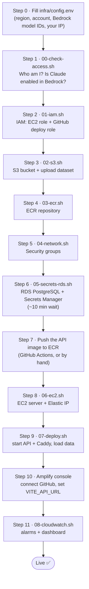
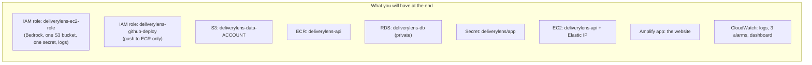
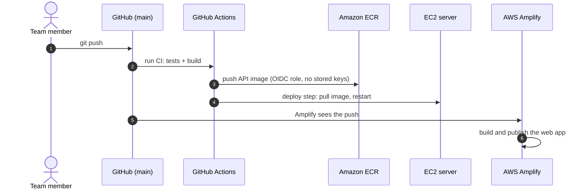

# 6. AWS setup guide (Monday 26 October)

A step-by-step guide to put DeliveryLens live on AWS using only the 9 services we requested.
Every step is a script in `infra/scripts/`, and every script is safe to run twice.

## The order of steps



**What this shows:** the steps run from top to bottom, about 2–3 hours in total, most of it
waiting for RDS. Each box names the script to run.

## Step 0: fill in the placeholders

```bash
cp infra/config.env.example infra/config.env
# edit infra/config.env and replace every <PLACEHOLDER>
```

| Placeholder | Where to get it | Example |
|---|---|---|
| `<AWS_REGION>` | From L&D or the IT team (Satya) | `ap-south-1` |
| `<AWS_ACCOUNT_ID>` | `aws sts get-caller-identity` | `123456789012` |
| `<BEDROCK_HAIKU_MODEL_ID>`, `<BEDROCK_SONNET_MODEL_ID>` | Printed by step 1 | an Anthropic Claude model or inference-profile ID |
| `<YOUR_PUBLIC_IP>` | Search "what is my ip" | `203.0.113.10` |
| `<AMPLIFY_APP_ID>` | After step 10; then re-run step 6 to update the secret | `d1abc2xyz` |

## Step 1 to Step 11: what each one does



**What this shows:** the AWS resources that will exist after setup. All names start with
`deliverylens`, so they are easy to find and to delete afterwards (`99-teardown.sh`).

| Step | Run | What happens | How to check |
|---|---|---|---|
| 1 | `bash infra/scripts/00-check-access.sh` | Prints your identity, the Claude models you can use, and OK/FAIL for each service | Every line says OK. Post any FAIL in the infra Teams group |
| 2 | `bash infra/scripts/01-iam.sh` | Creates the two IAM roles with least privilege | Prints the GitHub deploy role ARN; save it as GitHub secret `AWS_DEPLOY_ROLE_ARN` |
| 3 | `bash infra/scripts/02-s3.sh` | Private, encrypted bucket; uploads `data/halcyon-dataset` to `raw/` | `aws s3 ls s3://deliverylens-data-<account>/raw/halcyon-dataset/` |
| 4 | `bash infra/scripts/03-ecr.sh` | Image repository with scan-on-push | Prints the image URI |
| 5 | `bash infra/scripts/04-network.sh` | API: 443/80 open, 22 from your IP only. DB: 5432 from the API only | Save the printed API security group ID as GitHub secret `EC2_SG_ID` (the deploy job opens SSH for itself only while it deploys, then closes it) |
| 6 | `bash infra/scripts/05-secrets-rds.sh` | Creates PostgreSQL (private, encrypted) and stores the connection string, model IDs and a demo password in Secrets Manager | Prints the RDS endpoint |
| 7 | Push to `main` (GitHub Actions builds and pushes), or build by hand, see below | The API image lands in ECR | `aws ecr list-images --repository-name deliverylens-api` |
| 8 | `bash infra/scripts/06-ec2.sh` | Starts the server, installs Docker, attaches a fixed IP | Prints `https://<ip-with-dashes>.sslip.io` |
| 9 | `bash infra/scripts/07-deploy.sh` | Copies the compose file, pulls the secret and the image, starts API + Caddy, loads the data once | Ends with the `/api/health` JSON |
| 10 | Amplify console → New app → GitHub → `halcyon-deliverylens`, branch `main` | Builds `frontend/` using `amplify.yml`. Set env var `VITE_API_URL=https://<ip-with-dashes>.sslip.io` | Open the Amplify URL; the Overview page shows 71% |
| 11 | `bash infra/scripts/08-cloudwatch.sh` | Log retention, error metric, 3 alarms, dashboard | Open the printed dashboard link |

Build and push the image by hand (only if GitHub Actions is not set up yet):
```bash
source infra/config.env
aws ecr get-login-password | docker login --username AWS --password-stdin $AWS_ACCOUNT_ID.dkr.ecr.$AWS_REGION.amazonaws.com
docker build -f backend/Dockerfile -t $AWS_ACCOUNT_ID.dkr.ecr.$AWS_REGION.amazonaws.com/deliverylens-api:latest .
docker push $AWS_ACCOUNT_ID.dkr.ecr.$AWS_REGION.amazonaws.com/deliverylens-api:latest
```

## How updates reach AWS after Monday



**What this shows:** after setup, a `git push` to `main` updates everything.
1. GitHub Actions runs the tests, builds the API image and pushes it to ECR.
2. GitHub Actions opens SSH for its own IP only, tells the EC2 server to pull the new image and
   restart, then closes SSH again.
3. Amplify rebuilds the website on its own.

Nobody copies files by hand.

## If something goes wrong

| Problem | Likely cause | Fix |
|---|---|---|
| Website loads but shows "API unreachable" | `VITE_API_URL` missing or wrong in Amplify, or CORS | Set the variable in Amplify and redeploy; check `CORS_ORIGINS` in the secret matches the Amplify URL |
| `https://…sslip.io` fails | Port 80 or 443 blocked, or the certificate is not ready yet | Check the security group; wait one minute; `docker logs` the caddy container |
| AI answers say "mock" | `LLM_PROVIDER` not `bedrock`, or model access missing | Update the secret, run `07-deploy.sh` again; check step 1 output |
| `AccessDenied` from Bedrock | Model not enabled, or wrong model ID for the region | Use the inference-profile ID printed in step 1 |
| RDS connection refused | Security group | Re-run `04-network.sh`; the DB accepts traffic only from the API security group |

## After the hackathon

Run `bash infra/scripts/99-teardown.sh` (it asks you to type DELETE). L&D will revoke access anyway.
