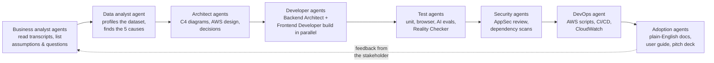
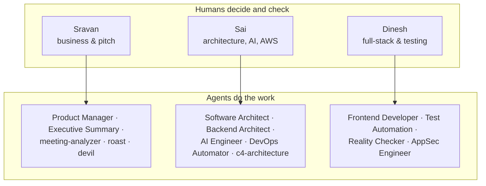

# 7. How we work with AI agents

AI-first delivery is the biggest scoring area: 30 of 100 points. The judges want to see AI agents
used in **every role**, from business analysis to adoption, not only for writing code. This page
shows how we do that and where the proof lives.

## The agent pipeline

**What this shows:** each role in the project has an AI agent doing the heavy lifting, and a
human checking the result.
- Example: the **Backend Architect agent** built the API and its tests, and Sai reviewed it.
- Example: the **data analysis** that found the five causes was done by Claude Code and checked
  by the team against the raw CSVs.

## Who does what: humans and agents

**What this shows:** three humans, each leading a small group of agents. The humans give the
direction, review every output, and own the decisions. The agents and skills are stored in
`.claude/agents/` and `.claude/skills/`, so every team member gets the same setup from git.

## Where the proof lives

| Evidence | Where | Example |
|---|---|---|
| AI usage log per role | `ai-logs/` (index in `ai-logs/INDEX.md`) | `ai-logs/backend-agent-2026-10-23.md`: what the backend agent built, the skills it used, the test results |
| AI calls made by the product | `agent_runs` table, the "Agent activity" screen, CloudWatch logs | Every Order Intake Agent call: model, time taken, tokens, guardrail flags |
| Skills and agents available | `.claude/skills/` (95), `.claude/agents/` (43), catalogue in `tools/fde-toolkit/README.md` | `fde-design`, `c4-architecture`, `test-driven-development` |
| Reproducible analysis | `analysis/root_cause_analysis.py` → `analysis/output/findings.json` | Re-run it and get exactly the same 71.0% / 96.6% |

## Rules we follow when using agents

1. **A human reviews every agent output** before it is merged or sent to anyone.
2. **Agents never compute KPIs inside the product.** The code does the maths; AI reads and writes text.
3. **Every agent session gets a log entry** in `ai-logs/` (who, what, which skills, the result, the reviewer).
4. **No real personal data** goes to any AI tool; only the synthetic hackathon data.
5. **Prove before claiming.** "Done" means tests pass, screenshots exist, or the URL works.
