# 8. User guide: every screen, every button, every number

This guide walks through the DeliveryLens app one screen at a time. Each picture has **red numbered
boxes**. The table under the picture explains each number: what it is, what the figures mean and
what the buttons do.

New to the project? Read [00-START-HERE.md](00-START-HERE.md) first (one page). Then open the app
and follow this guide from top to bottom.

**Contents**
1. [The menu on the left](#1-the-menu-on-the-left)
2. [How it works: the client's process, start to end](#2-how-it-works-the-clients-process-start-to-end)
3. [Order desk (live): emails in, warehouse orders out](#3-order-desk-live-emails-in-warehouse-orders-out)
4. [The 12 sample emails: good cases and bad cases](#4-the-12-sample-emails-good-cases-and-bad-cases)
5. [Overview](#5-overview)
6. [Why deliveries are late](#6-why-deliveries-are-late)
7. [Vendor decision](#7-vendor-decision)
8. [What-if simulator](#8-what-if-simulator)
9. [Carriers](#9-carriers)
10. [At-risk clients](#10-at-risk-clients)
11. [Stock & routes](#11-stock--routes)
12. [Order intake agent](#12-order-intake-agent)
13. [Ask DeliveryLens](#13-ask-deliverylens)
14. [Agent activity](#14-agent-activity)
15. [The "What am I looking at?" panel](#15-the-what-am-i-looking-at-panel)
16. [Where the AI is, which framework, and in which phase](#16-where-the-ai-is-which-framework-and-in-which-phase)
17. [Turning on real AI answers with Google Gemini](#17-turning-on-real-ai-answers-with-google-gemini)
18. [Blockers and open items](#18-blockers-and-open-items)

---

## 1. The menu on the left

Every screen has the same menu on the left. It is split into four groups:

| Group | Screens | What the group is for |
|---|---|---|
| **Start here** | How it works | The client's process, and where we act in it. Open this first. |
| **The decision** | Overview, Why deliveries are late, Vendor decision, What-if simulator | The answer for the COO and CFO: why deliveries are late, and whether to buy the $680K routing tool. |
| **Operations** | Carriers, At-risk clients, Stock & routes | The detail behind each cause, for the operations team. |
| **AI agents** | Order desk (live), Order intake agent, Ask DeliveryLens, Agent activity | The AI agents working, and the log of everything they did. |

Two small things in the menu:
- **The purple badge under the logo** ("AI: Mock (canned)") tells you which AI is answering right now.
  - **Mock (canned)**: prepared answers, no internet needed. Good for a safe demo.
  - **Gemini**: real Google AI answers. You turn it on with your own key (see [section 17](#17-turning-on-real-ai-answers-with-google-gemini)).
  - **Bedrock**: Claude on Amazon, used once we deploy to AWS.
- **"48,340 deliveries, 1 Apr – 25 Sep 2026"** at the bottom is the size of the data behind every number in the app.

---

## 2. How it works: the client's process, start to end

**Menu:** Start here → How it works. This is the landing page.

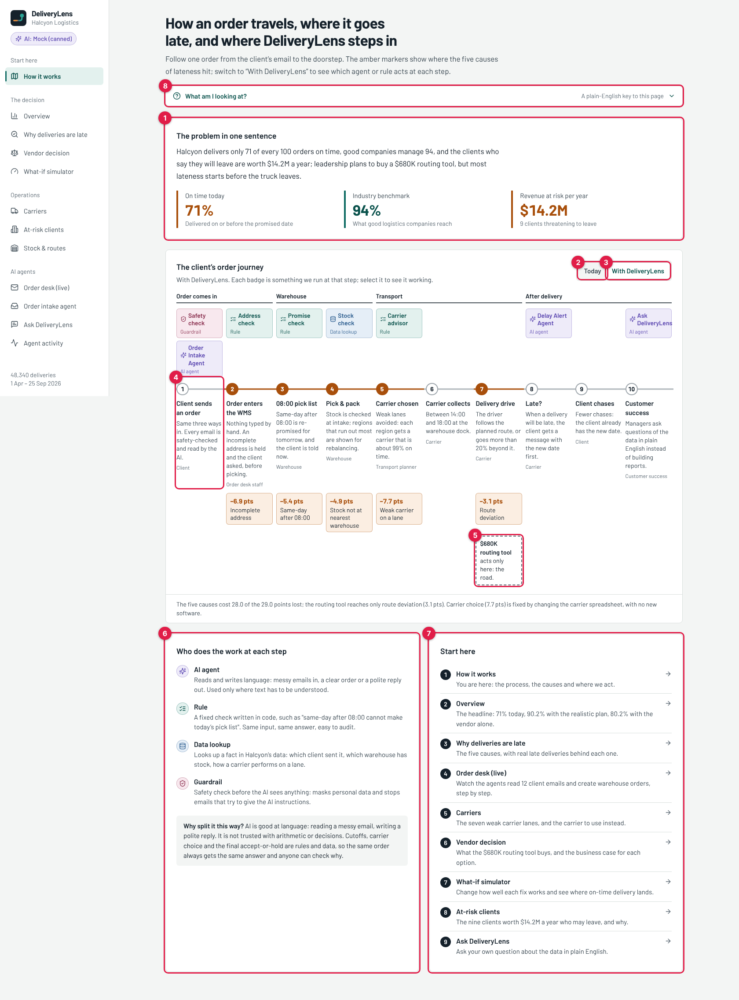

| # | What it is | What it means |
|---|---|---|
| 1 | **The problem in one sentence** | Three numbers sum up the problem. **71%**: deliveries that arrive on or before the promised date today. **94%**: what good logistics companies reach. **$14.2M**: the yearly revenue of the 9 clients who say they may leave. |
| 2 | **Today** button | Shows the order journey as Halcyon runs it now: emails typed by hand, one 08:00 pick list, carrier from a price spreadsheet. |
| 3 | **With DeliveryLens** button | Shows the same journey with our agents and rules added. The coloured badges above the steps appear: each badge is something DeliveryLens runs at that step. Click a badge to open the screen where it works. |
| 4 | **Step 1, "Client sends an order"** | The order journey has 10 numbered steps, from the client's email (step 1) to customer success (step 10). Each step says who does it today (Client, Order desk staff, Warehouse, Carrier and so on). **Orange circles** mark the steps where lateness starts. |
| 5 | **"$680K routing tool acts only here: the road"** | The dashed box sits under step 7, the delivery drive. That is the only step the routing software touches. The **amber boxes** above it show the points of on-time delivery each cause costs: −7.7 weak carrier, −6.9 incomplete address, −5.4 same-day after 08:00, −4.9 stock not at the nearest warehouse, −3.1 route deviation. Only the last one is on the road. |
| 6 | **Who does the work at each step** | The key to the badge colours. **AI agent** (purple): reads and writes language. **Rule** (green): a fixed check in code, same answer every time. **Data lookup** (blue): looks up a fact in Halcyon's data. **Guardrail** (red): a safety check before the AI sees anything. |
| 7 | **Start here** list | The suggested order to explore the app. Each row opens that screen. |
| 8 | **What am I looking at?** | A plain-English key to the page. Every screen has one. See [section 15](#15-the-what-am-i-looking-at-panel). |

**A "point"** in this app means one percentage point of on-time delivery. Going from 71% to 72% is +1 point.

---

## 3. Order desk (live): emails in, warehouse orders out

**Menu:** AI agents → Order desk (live). **This is the main demo screen.** It shows the client's
real process happening on screen: an email arrives, the AI reads it, rules check it, and an order
lands in the warehouse system.

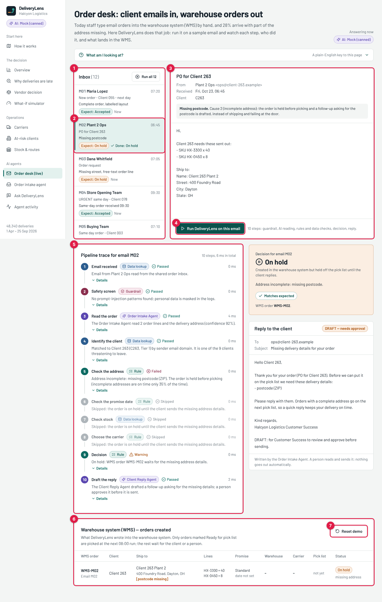

| # | What it is | What it means |
|---|---|---|
| 1 | **Inbox (12)** | The shared order mailbox. These are the emails clients send to Halcyon's order desk. Each row shows the message id (M01 to M12), the sender, the subject and a one-line description of the case. **"Expect: …"** is what the right answer should be. **"New"** means not processed yet; **"Done: …"** shows what DeliveryLens decided. **Run all 12** processes every new email in one go. |
| 2 | **Email M02 (selected)** | The email you clicked. Here, M02 from "Plant 2 Ops" for Client 263, which is missing a postcode. |
| 3 | **The email itself** | Sender, time received, the client it belongs to, and the full email text. The grey box explains in one line which cause this email shows. |
| 4 | **Run DeliveryLens on this email** | Starts the 10-step pipeline for this one email. It takes a second with Mock, a few seconds with Gemini. |
| 5 | **Pipeline trace** | Every step the email went through, in order, with **who did it** (the badge), the **result** (Passed, Failed, Warning or Skipped), **how long it took** (ms = thousandths of a second) and a one-line reason. Click **Details** to see the raw data of a step, for example the fields the AI extracted. The 10 steps are listed below this table. |
| 6 | **Warehouse system (WMS)** | The orders DeliveryLens wrote into the warehouse system. Only rows marked **Ready for pick list** are picked at the next 08:00 run. The rest wait for the client or a person. |
| 7 | **Reset demo** | Clears the WMS table and marks all 12 emails as new again, so you can run the demo from the start. |

To the right of the trace (not numbered) are two more cards:
- **Decision for email M02**: the final result (**On hold** here), the reason ("missing postcode"), and **Matches expected**, which proves the result is the one we planned for this email.
- **Reply to the client**: the email the **Client Reply Agent** drafted. It is marked **DRAFT — needs approval**: a person reads and sends it. Nothing goes to a client automatically.

### The 10 steps in the pipeline trace

| Step | Name | Who does it | What it checks or does |
|---|---|---|---|
| 1 | Email received | Data lookup | Reads the email (and any attachment) from the shared inbox. |
| 2 | Safety screen | **Guardrail** | Blocks emails that try to give the AI instructions ("ignore your instructions…"). Masks personal data such as email addresses and phone numbers before anything is logged. |
| 3 | Read the order | **AI: Order Intake Agent** | Reads the free-text email like a person would and pulls out: client, PO number, order lines (SKU and quantity), delivery address, promise type (same-day, next-day, standard) and a confidence score. It also reads CSV attachments. |
| 4 | Identify the client | Data lookup | Matches the sender's email domain to a client on file, and flags the 9 at-risk clients. |
| 5 | Check the address | Rule | Street, city, state and postcode must all be there. Country defaults to US. If anything is missing, the order is put **on hold** before picking. |
| 6 | Check the promise date | Rule | A same-day order after 08:00 cannot make today's pick list, so it is honestly re-promised for the next day. |
| 7 | Check stock | Data lookup | Is the item in stock at the warehouse nearest the client? If not, which warehouse has it? |
| 8 | Choose the carrier | Rule | Picks the best carrier for the destination region, avoiding the 7 weak lanes, instead of the cheapest one from the rate card. |
| 9 | Decision | Rule | **Accepted**, **On hold**, **Needs review** or **Blocked**. Writes the row in the WMS table. |
| 10 | Draft the reply | **AI: Client Reply Agent** | Writes a confirmation, or a polite request for the missing details, for a person to approve. |

**Why only steps 3 and 10 use AI:** AI is good at language: reading a messy email, writing a polite
reply. It is not trusted with arithmetic or business decisions. The cutoff, the carrier choice and
the final accept-or-hold are rules and data, so the same order always gets the same answer and
anyone can check why.

### What the results look like

**A good case: M01 accepted.** Every step passes. The order goes into the WMS as "Ready for pick list".

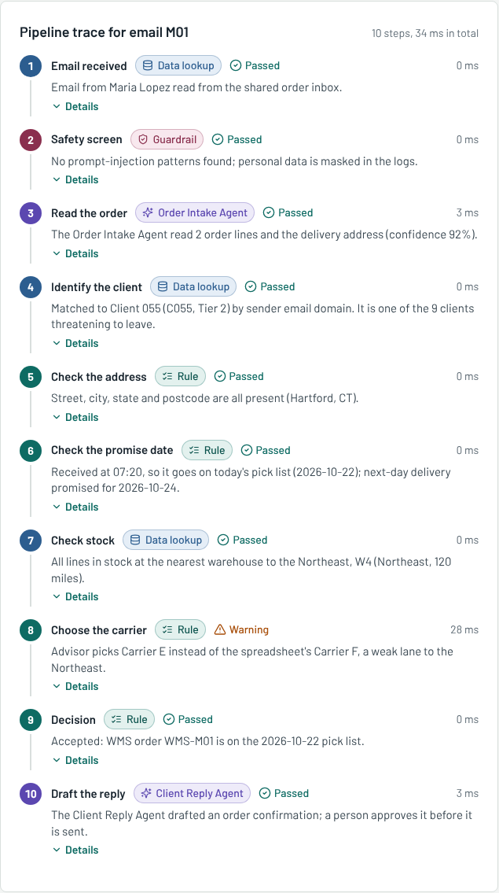

**A blocked case: M10, prompt injection.** The safety screen (step 2) fails. Every later step is
skipped: nothing is sent to the AI and nothing goes into the warehouse system.

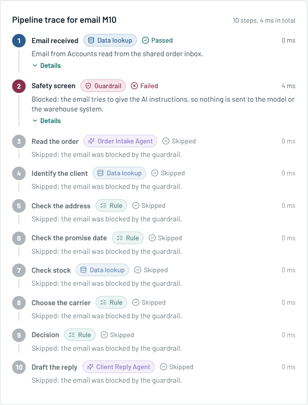

**A same-day order after the cutoff: M04.** The order is accepted, but step 6 shows a warning: it
arrived at 09:30, after the 08:00 pick list, so it is re-promised for the next day instead of
silently arriving late.

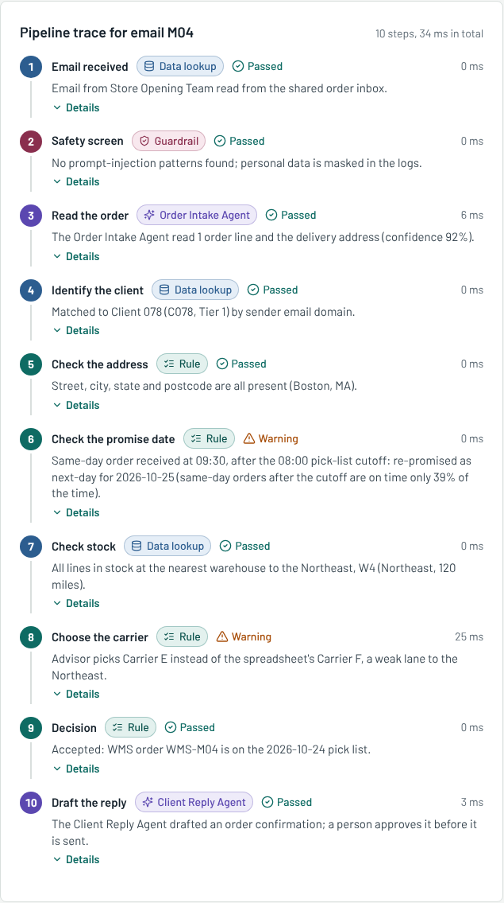

### The warehouse system (WMS) after "Run all 12"

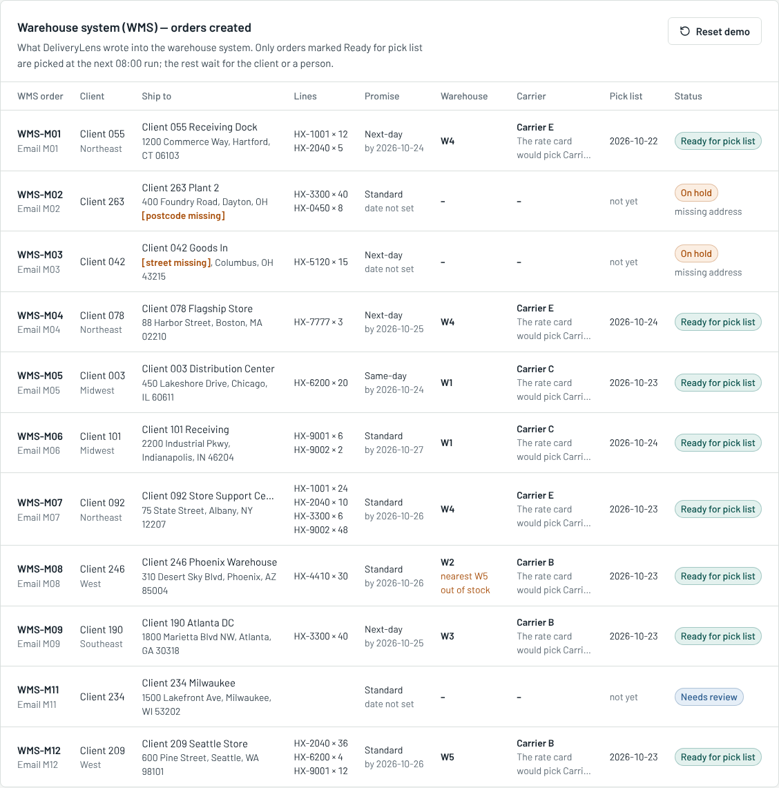

| Column | What it means |
|---|---|
| WMS order | The order number in the warehouse system (WMS-M01 comes from email M01). |
| Client | The client the email was matched to, and its region. |
| Ship to | The delivery address. **[postcode missing]** or **[street missing]** in orange shows what is missing. |
| Lines | The items: SKU × quantity. |
| Promise | Same-day, next-day or standard, and the date we promise. "date not set" means the order is waiting. |
| Warehouse | The warehouse that will pick it (W1 to W5). Orange text such as "nearest W5 out of stock" means it ships from further away. |
| Carrier | The carrier chosen by our rule. The grey line underneath says which carrier the old rate card would have picked, for comparison. |
| Pick list | The date of the 08:00 pick list it goes on. "not yet" means it is waiting. |
| Status | **Ready for pick list**, **On hold** (missing address), or **Needs review** (a person must check). Blocked emails (M10) never reach the WMS. |

**About the WMS:** Halcyon's real warehouse system is not available to us. The WMS here is a simple
table (`wms_orders`) in our database that stands in for it. In production, step 9 would call the
WMS's own API instead of writing to this table. Nothing else changes.

**Where the emails come from:** for the demo, the 12 emails are real `.eml` files in
`data/sample-inbox/` (the format any mail server saves). The loader reads them, with attachments,
into the `inbox_messages` table. In production the same code would read from Halcyon's shared order
mailbox (for example by IMAP, or through Amazon SES storing new mail in S3).

---

## 4. The 12 sample emails: good cases and bad cases

The dataset has no email text, so we wrote 12 emails that cover the typical good and bad cases.
With the Mock AI, all 12 give exactly the expected result. With Gemini, the wording of the replies
changes every time, but the decisions are made by rules, so they stay the same.

| Email | Case | Good or bad? | Expected result | What it shows |
|---|---|---|---|---|
| M01 | Complete order, labelled layout | ✅ Good | Accepted | A clean email from an at-risk client goes straight to the pick list, no typing. The old rate card would have used Carrier F, which is weak to the Northeast. |
| M02 | Missing postcode | ❌ Bad | On hold | Cause 2 (incomplete address): held before picking, follow-up drafted asking for the postcode. |
| M03 | Missing street, free-text order line | ❌ Bad | On hold | Cause 2 again with a different layout: only city, state and ZIP given. |
| M04 | Same-day order received 09:30 | ⚠️ Risky | Accepted, re-promised next day | Cause 3 (same-day after 08:00): accepted, but honestly promised for tomorrow. |
| M05 | Same-day order received 07:10 | ✅ Good | Accepted | Before the 08:00 cutoff, so it keeps its same-day promise. |
| M06 | Address written on one line | ✅ Good | Accepted | The AI reads a one-line address, which a fixed template cannot. |
| M07 | Text table with four lines | ✅ Good | Accepted | A different client layout is read without a template for it. |
| M08 | West client, nearest warehouse out of stock | ⚠️ Risky | Accepted, ships from further away | Cause 4 (stock not at the nearest warehouse): W5 West has no HX-4410, so it ships from the Midwest and the agent warns about it. |
| M09 | Southeast client | ⚠️ Risky | Accepted, carrier changed | Cause 1 (weak carrier): the rate card picks Carrier F, about 53% on time to the Southeast; the advisor picks a strong carrier. |
| M10 | Prompt injection in the body | ❌ Attack | Blocked | The guardrail stops an email that tries to give the AI instructions. Nothing reaches the AI or the WMS. |
| M11 | "A couple of pallets of the usual" | ❌ Unclear | Needs review | No SKU and no number, so the agent does not guess; a person checks it. |
| M12 | Order lines only in an attached CSV | ✅ Good | Accepted | The agent reads the attachment as well as the email body. |

### How DeliveryLens decides an address is good enough

This is a **rule**, not AI, so it is always the same and easy to explain:

1. The AI (step 3) pulls out the address fields it can find: name, street, city, state, postcode,
   country. It is told **never to invent a field** that is not in the email.
2. The rule (step 5) checks that **street, city, state and postcode** are all present. Country
   defaults to US when not given.
3. Any field missing → the order goes **On hold**, and the reply asks for exactly the missing
   fields (for example "postcode (ZIP)").
4. Why it matters: in the data, deliveries with an incomplete address are on time only **35%** of
   the time.

### When an order goes to a person ("Needs review")

- no order line with a clear SKU and quantity,
- the AI's confidence is below 60%,
- or the sender does not match any client on file.

---

## 5. Overview

**Menu:** The decision → Overview. The headline for the leadership team.

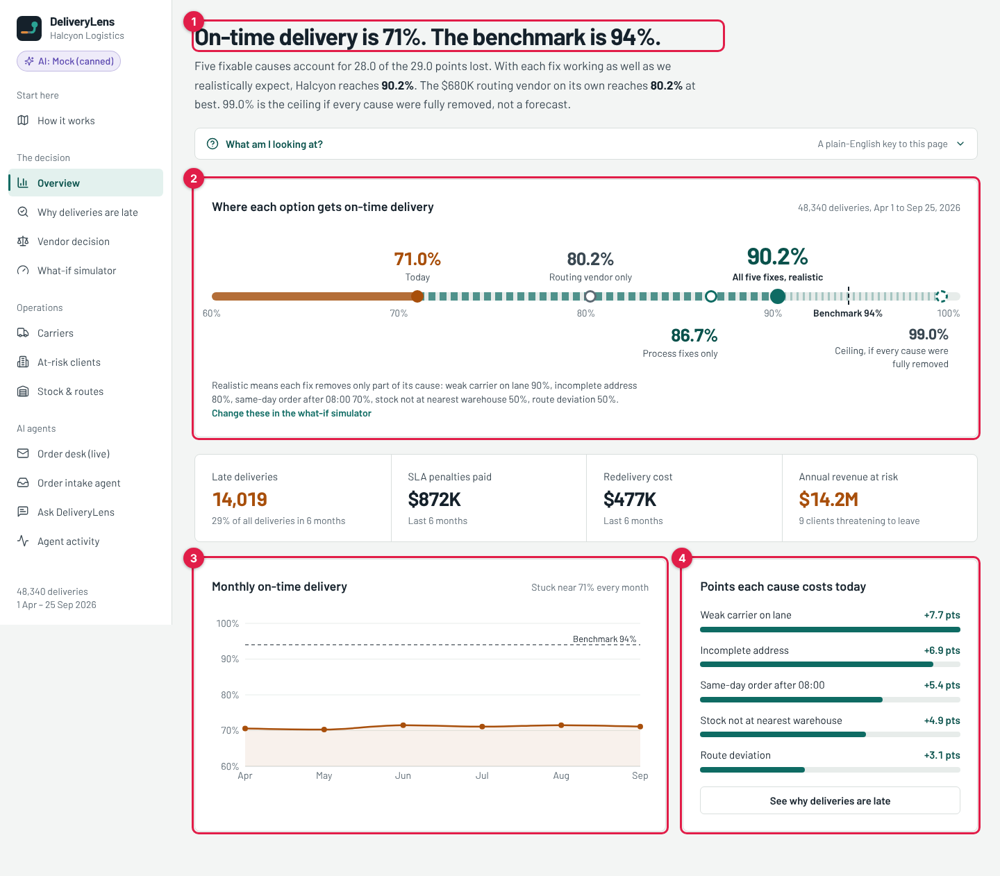

| # | What it is | What it means |
|---|---|---|
| 1 | **Headline** | On-time delivery is 71% today; the benchmark is 94%. The line under it gives the answer in one sentence. |
| 2 | **Where each option gets on-time delivery** | One line from 60% to 100% with each option marked: **71.0% today**, **80.2% routing vendor only** (its best case), **86.7% process fixes only** (address, cutoff, stock), **90.2% all five fixes, realistic** (our plan), **99.0% ceiling** (if every cause were removed completely; a limit, not a forecast). The dashed mark is the 94% benchmark. "Change these in the what-if simulator" opens [section 8](#8-what-if-simulator). |
| 3 | **Monthly on-time delivery** | On-time % for each month, April to September. It stays near 71% every month, so this is a steady problem, not a bad month. |
| 4 | **Points each cause costs today** | How many points of on-time delivery each of the five causes costs. +7.7 for weak carrier means removing that cause completely would add 7.7 points. "See why deliveries are late" opens the next screen. |

The four tiles in the middle (not numbered): **14,019** late deliveries (29% of all) in 6 months;
**$872K** SLA penalties paid; **$477K** redelivery cost; **$14.2M** yearly revenue from the 9
clients threatening to leave.

---

## 6. Why deliveries are late

**Menu:** The decision → Why deliveries are late.

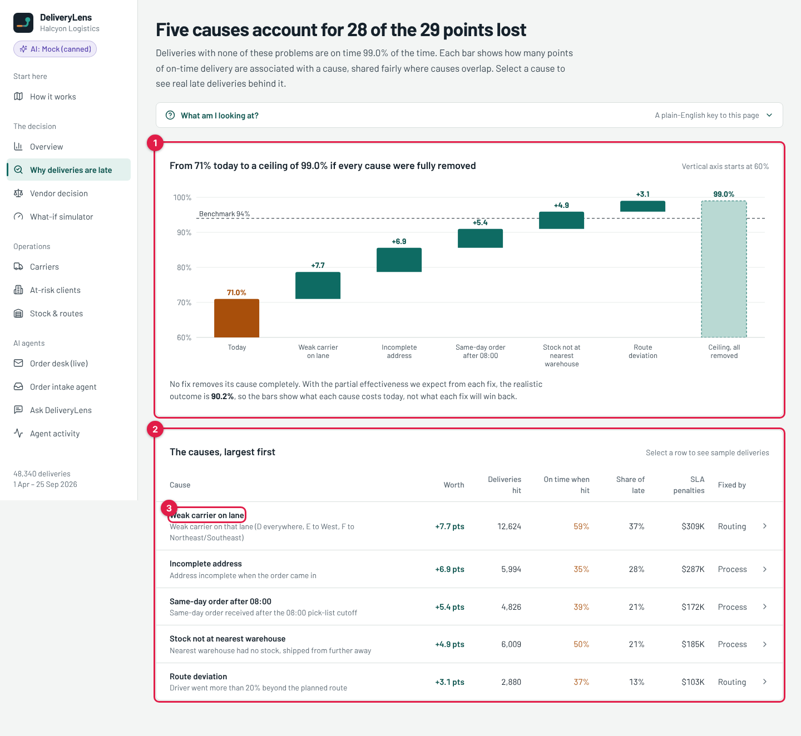

| # | What it is | What it means |
|---|---|---|
| 1 | **Waterfall chart** | Starts at **71.0% today** and adds each cause's points: +7.7, +6.9, +5.4, +4.9, +3.1, up to the **99.0% ceiling**. Deliveries with none of these problems are on time 99% of the time. When two causes hit the same delivery, the points are shared fairly between them (a method called Shapley values), so the bars add up exactly. |
| 2 | **The causes, largest first** | One row per cause. **Worth**: points of on-time delivery it costs. **Deliveries hit**: how many of the 48,340 deliveries had this problem. **On time when hit**: how often those deliveries were still on time (for example only 35% with an incomplete address). **Share of late**: what share of all late deliveries had this cause. **SLA penalties**: penalties paid on those deliveries in 6 months. **Fixed by**: whether routing software or a process change fixes it. |
| 3 | **A cause row (click it)** | Opens a list of real late deliveries with that cause, so you can see actual examples behind the number. |

---

## 7. Vendor decision

**Menu:** The decision → Vendor decision. The answer to the $680K question.

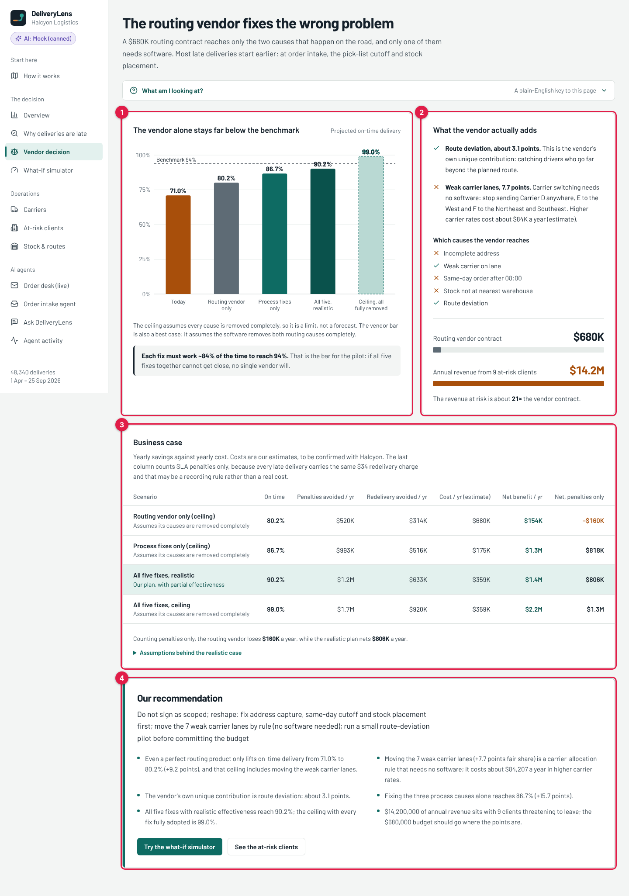

| # | What it is | What it means |
|---|---|---|
| 1 | **The vendor alone stays far below the benchmark** | Bar chart of projected on-time delivery: 71.0% today, 80.2% routing vendor only, 86.7% process fixes only, 90.2% all five realistic, 99.0% ceiling. The grey box says each fix would have to work about 84% of the time to reach 94%. |
| 2 | **What the vendor actually adds** | The routing tool reaches only two causes: route deviation (3.1 points) and weak carrier lanes (7.7 points), and the carrier one needs no software, only a new carrier rule. The list shows ✓ for causes the vendor reaches and ✗ for those it cannot. The bars compare the **$680K** contract with the **$14.2M** revenue at risk (about 21 times more). |
| 3 | **Business case** | One row per option, per year. **On time**: projected on-time %. **Penalties avoided** and **Redelivery avoided**: money saved. **Cost / yr (estimate)**: our estimate of what the option costs. **Net benefit / yr**: savings minus cost. **Net, penalties only**: the same, counting only SLA penalties (the safest view). The highlighted row is our plan: **$1.4M** a year net. The vendor alone **loses $160K** a year on penalties only. "Assumptions behind the realistic case" opens the estimates. |
| 4 | **Our recommendation** | Do not sign the vendor contract as scoped. Fix address capture, the same-day cutoff and stock placement first; move the 7 weak carrier lanes by rule; run a small route-deviation pilot before spending the budget. The two buttons open the what-if simulator and the at-risk clients. |

**Important:** costs and "how well each fix works" are **our estimates**, clearly labelled, for
Halcyon to confirm. Everything else is calculated from the data.

---

## 8. What-if simulator

**Menu:** The decision → What-if simulator. Lets the client challenge our assumptions live.

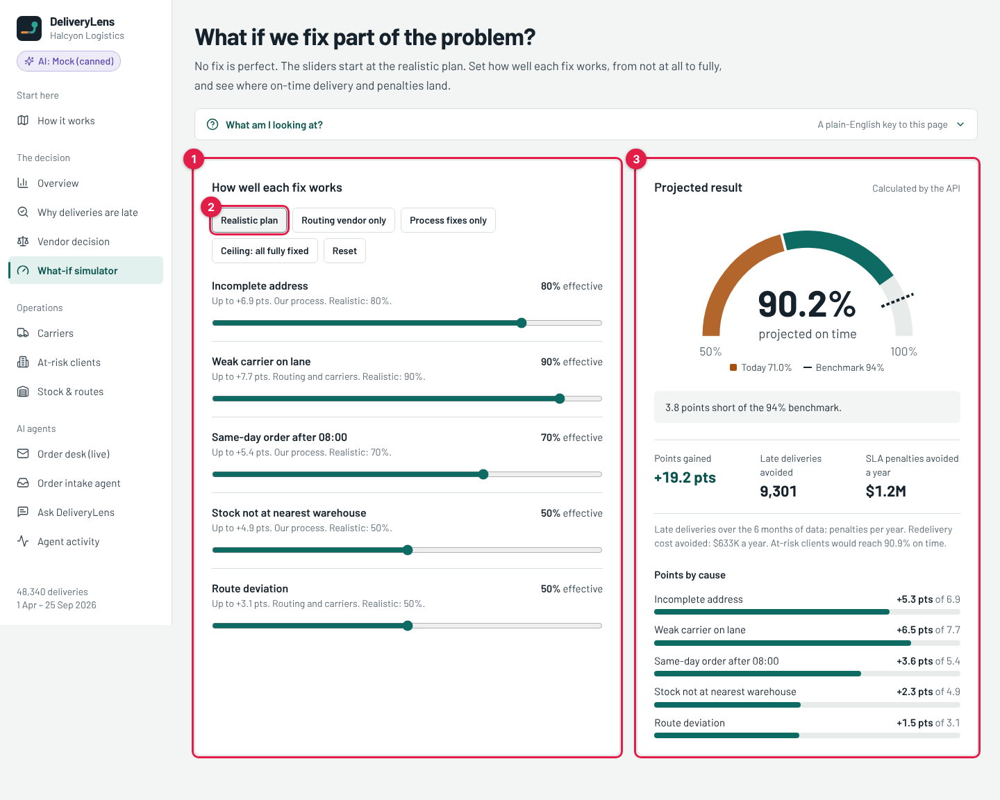

| # | What it is | What it means |
|---|---|---|
| 1 | **How well each fix works (sliders)** | One slider per cause, from 0% (the fix does nothing) to 100% (the cause is removed completely). "Up to +6.9 pts" is the most that fix can give. "Realistic: 80%" is our estimate. Drag a slider and the result on the right updates at once. |
| 2 | **Preset buttons** | **Realistic plan**: our estimates. **Routing vendor only**: only the two road causes, at 100%. **Process fixes only**: address, cutoff, stock at 100%. **Ceiling: all fully fixed**: everything at 100%. **Reset**: back to the realistic plan. |
| 3 | **Projected result** | The gauge shows projected on-time delivery (**90.2%** for the realistic plan) against today (71%, orange) and the 94% benchmark (dotted line). The grey box says how far it is from the benchmark. **Points gained**: +19.2. **Late deliveries avoided**: 9,301 over the 6 months of data. **SLA penalties avoided a year**: $1.2M. **Points by cause**: how many of each cause's points the current slider setting wins back ("+5.3 pts of 6.9"). The numbers are calculated by the backend from the real data, not in the browser. |

---

## 9. Carriers

**Menu:** Operations → Carriers. Cause 1, the biggest one.

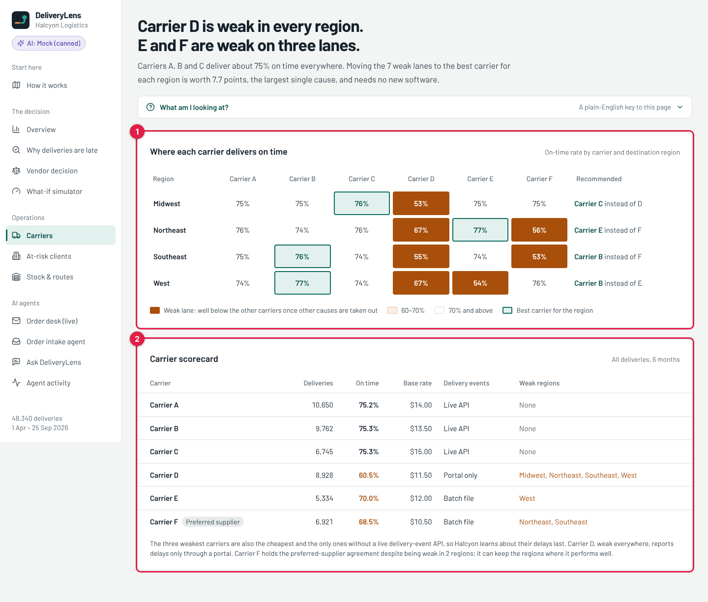

| # | What it is | What it means |
|---|---|---|
| 1 | **Where each carrier delivers on time (heatmap)** | On-time % for each carrier (columns A to F) in each region (rows). **Brown cells** are the 7 weak lanes: Carrier D in all four regions, E to the West, F to the Northeast and Southeast. **Green-outlined cells** are the best carrier for that region. **Recommended** says which carrier to use instead. |
| 2 | **Carrier scorecard** | One row per carrier. **Deliveries**: how many it carried. **On time**: its overall on-time %. **Base rate**: price per delivery. **Delivery events**: how the carrier reports delays (live API, batch file, or only a portal). **Weak regions**: where it is weak. The note at the bottom: the three weakest carriers are also the cheapest, and the only ones without a live delay feed. |

---

## 10. At-risk clients

**Menu:** Operations → At-risk clients. The 9 clients worth $14.2M.

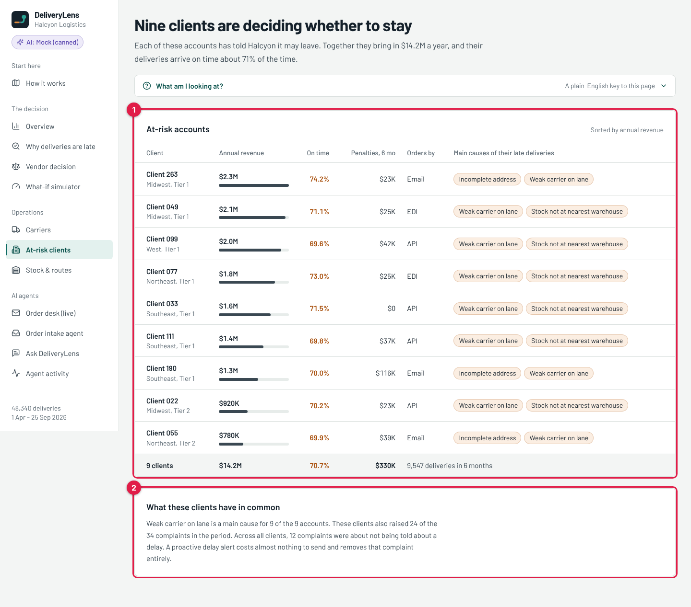

| # | What it is | What it means |
|---|---|---|
| 1 | **At-risk accounts** | One row per client, sorted by yearly revenue. **Annual revenue**: what they pay Halcyon a year (the bar shows the size). **On time**: their on-time %. **Penalties, 6 mo**: SLA penalties paid to them. **Orders by**: how they send orders (Email, EDI or API). **Main causes**: the top two causes behind their late deliveries. The last row is the total: 9 clients, $14.2M, 70.7% on time. |
| 2 | **What these clients have in common** | Weak carrier lane is a main cause for all 9. They raised 24 of the 34 complaints. 12 complaints were about not being told about a delay, which the Delay Alert Agent addresses. |

---

## 11. Stock & routes

**Menu:** Operations → Stock & routes. Causes 4 and 5.

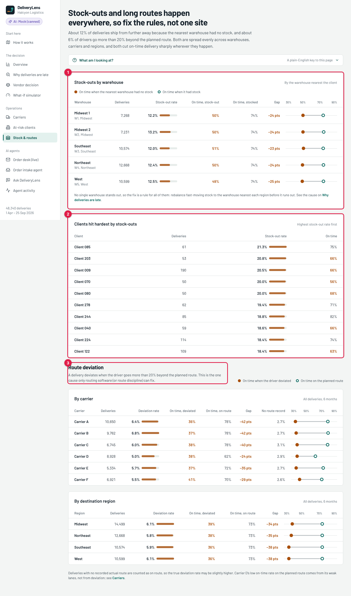

| # | What it is | What it means |
|---|---|---|
| 1 | **Stock-outs by warehouse** | For each warehouse: **Stock-out rate**: how often the nearest warehouse did not have the item. **On time, stock-out** vs **On time, stocked**: on-time % when it had to ship from further away, and when it did not. **Gap**: the difference (about −24 points everywhere). The dot chart shows the same gap: filled dot = stock-out, open dot = stocked. No warehouse stands out, so the fix is one rule for all of them. |
| 2 | **Clients hit hardest by stock-outs** | The clients whose orders most often ship from a further warehouse. |
| 3 | **Route deviation** | A delivery "deviates" when the driver goes more than 20% beyond the planned route. The two tables below (by carrier, by region) show the deviation rate and the on-time gap. Deviation is spread evenly, and it is the only cause routing software can fix. |

---

## 12. Order intake agent

**Menu:** AI agents → Order intake agent. The same AI as step 3 of the order desk, on its own, so you
can paste any email and test it.

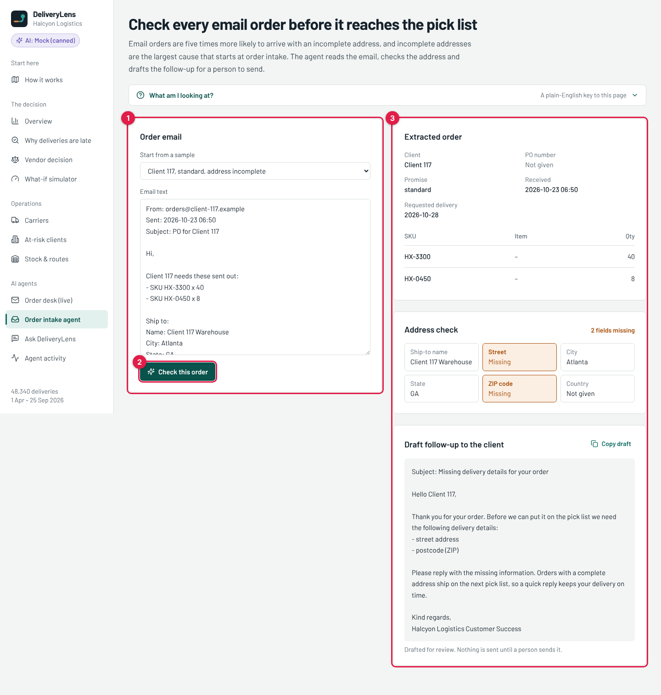

| # | What it is | What it means |
|---|---|---|
| 1 | **Order email** | Pick a sample from the list, or paste or type any order email into the box. |
| 2 | **Check this order** | Sends the email to the Order Intake Agent (after the guardrail). |
| 3 | **Result** | **Extracted order**: what the AI read (client, PO number, promise type, dates, SKU lines). **Address check**: each address field; orange "Missing" boxes are the fields the client must send. **Draft follow-up to the client**: the polite email asking for the missing details. **Copy draft** copies it. Nothing is sent until a person sends it. |

Try it: change the email text (for example, add a street line) and click **Check this order** again.
With Gemini on, the AI reads your new text and the reply changes.

---

## 13. Ask DeliveryLens

**Menu:** AI agents → Ask DeliveryLens. Managers ask questions in plain English.

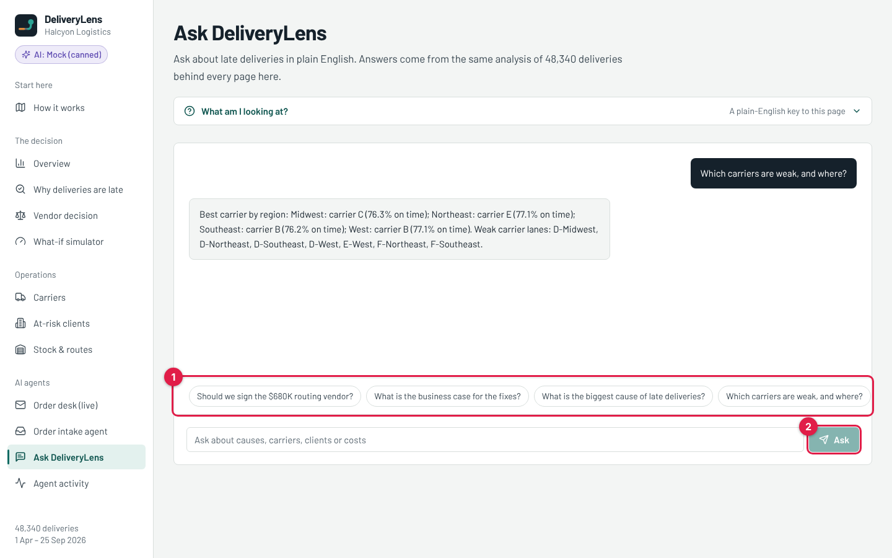

| # | What it is | What it means |
|---|---|---|
| 1 | **Suggested questions** | Click one to ask it. |
| 2 | **Ask** | Type your own question in the box and click Ask. |

**How it answers:** the AI first picks which data tool to use (for example "carrier scorecard" or
"business case"). The backend runs that tool on the real data. The AI then writes the answer using
only those numbers. So the AI never makes up a figure: every number comes from the same analysis as
the rest of the app. You can see both AI calls ("Ask: choose data tool" and "Ask DeliveryLens") on
the Agent activity screen.

---

## 14. Agent activity

**Menu:** AI agents → Agent activity. The audit log of every AI call.

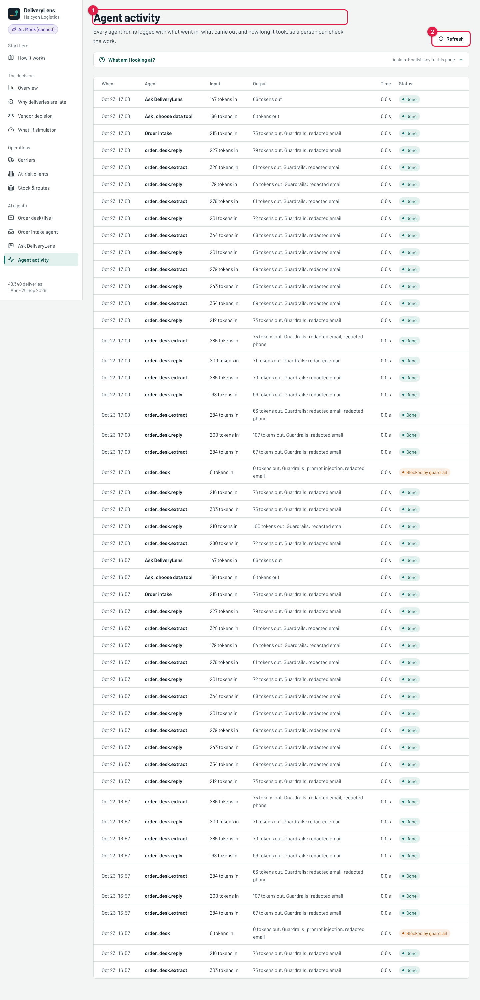

| # | What it is | What it means |
|---|---|---|
| 1 | **The log** | One row per AI call. **When**: time. **Agent**: which agent (order_desk.extract = Order Intake Agent in the desk, order_desk.reply = Client Reply Agent, Order intake, Ask DeliveryLens, Ask: choose data tool). **Input / Output**: size in tokens (roughly words) going in and out. **Guardrails**: what the safety screen did, for example "redacted email" (an email address was masked) or "prompt injection". **Time**: seconds taken (0.0 s with Mock; about 1–3 s with Gemini). **Status**: Done, or **Blocked by guardrail**. |
| 2 | **Refresh** | Reloads the log after you run more emails or questions. |

This is the proof for the judges that AI runs inside the product, and that a person can check every
call.

---

## 15. The "What am I looking at?" panel

Every screen has this bar near the top. Click it to open a short plain-English key to that page:
what each chart shows, what each number means and what to do next.

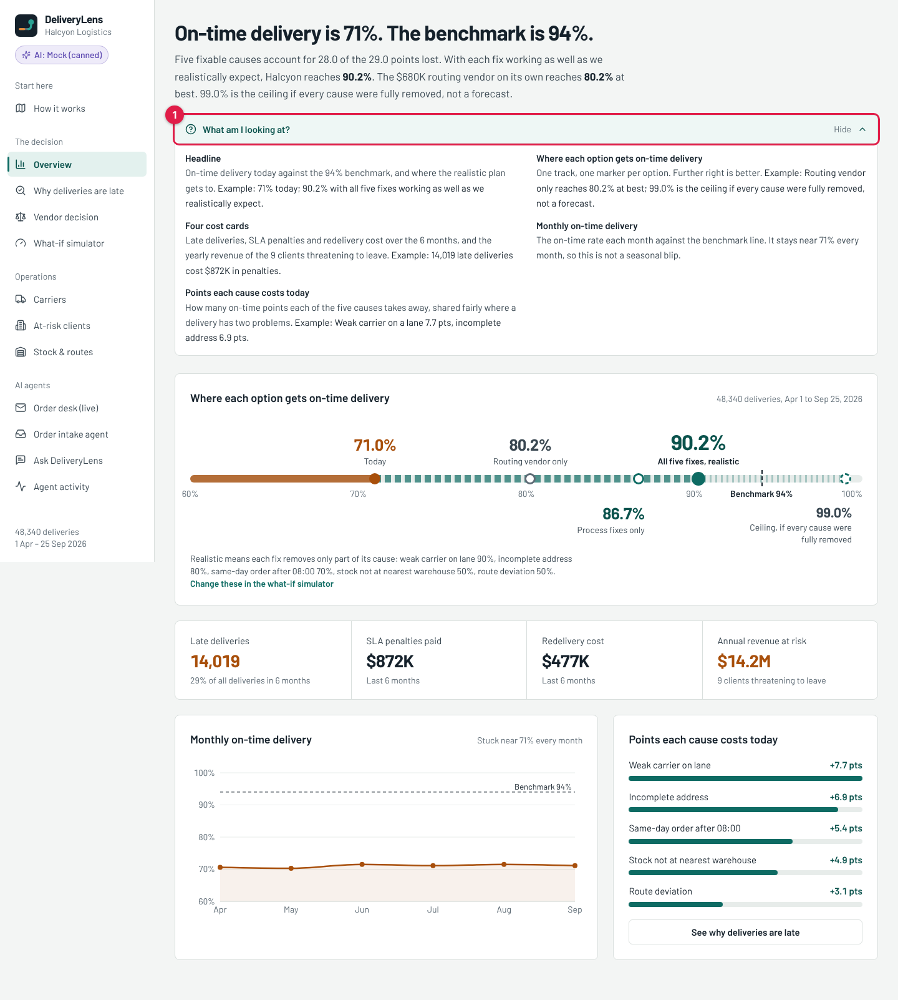

---

## 16. Where the AI is, which framework, and in which phase

### AI agents inside the product

| Agent | Where you see it | What it does | Why AI here |
|---|---|---|---|
| **Order Intake Agent** | Order desk step 3; Order intake agent screen | Reads a free-text email (and CSV attachments) and returns the order as structured data. | Every client writes differently. A fixed template cannot read "ship to 88 Harbor St Boston" on one line or a table layout. |
| **Client Reply Agent** | Order desk step 10 | Drafts the confirmation, or the request for missing details. | Writing a clear, polite email is language work. A person approves it. |
| **Delay Alert Agent** | How it works, step 8 (API: `/api/agents/delay-alert`) | Writes a warning to the client before a late delivery, with the new date. | 12 complaints were about not being told. A message costs almost nothing. |
| **Ask DeliveryLens** | Ask DeliveryLens screen | Picks a data tool, then answers in plain English using only those numbers. | Managers ask in their own words, not in SQL. |

What is **not** AI, on purpose: the address rule, the 08:00 cutoff, stock lookup, carrier choice,
the final decision and every number on every chart. These are rules and calculations, so they
always give the same, checkable answer.

### The framework

- **Our own small Python pipeline, no heavy framework** (no LangChain). Each step is a plain
  function in `backend/app/desk/pipeline.py`. A step gets the email, does one job and adds a line to
  the trace you see on screen. Small, fast and easy to test (148 backend tests).
- **One shared AI client** (`backend/app/agents/llm_client.py`) that can talk to three providers.
  The setting `LLM_PROVIDER` chooses one:
  - `mock`: canned answers, offline, the default;
  - `gemini`: Google Gemini, for demos on your laptop;
  - `bedrock`: Claude on Amazon Bedrock, used in the AWS deployment.
- **Structured output:** the AI must return JSON, which is checked against a schema (Pydantic). If
  the AI returns something broken, a simple backup parser is used and the step is flagged.
- **Guardrails** (`backend/app/guardrails.py`) run before every AI call: they block prompt
  injection, mask personal data and apply a rate limit.
- **Logging:** every AI call is stored in the `agent_runs` table and shown on the Agent activity
  screen (and in CloudWatch on AWS).

### In which phase

| Phase (5-day plan) | AI in the product | AI agents in the team's work |
|---|---|---|
| Discover (22–23 Oct) | – | Meeting analysis of the stakeholder call, question list, assumption log |
| Design (23 Oct) | Agent design: which steps are AI, rule or data | Architecture and C4 diagrams, AWS design |
| Build (23–25 Oct) | Order Intake, Client Reply, Delay Alert and Ask agents with Mock and Gemini | Backend and frontend agents build in parallel; analysis agent finds the 5 causes |
| Test (25–26 Oct) | AI evaluation on the 12 emails (`evidence/ai-agent-eval.md`) | Test agents write unit and browser tests; security agent reviews |
| Deploy (26–28 Oct) | Switch to Claude on Amazon Bedrock | DevOps agent runs the AWS scripts and CI/CD |
| Demo (Nov) | Live demo on the Order desk | Deck and pitch built by agents, reviewed by the team |

---

## 17. Turning on real AI answers with Google Gemini

With Mock, the AI answers are prepared in advance. With Gemini, the replies are written live, so
they change with the email you give it.

1. Get a free API key at **https://aistudio.google.com** → "Get API key".
2. In the `backend` folder, copy `.env.example` to a new file named `.env`.
3. In `backend/.env`, set:
   ```ini
   LLM_PROVIDER=gemini
   GEMINI_API_KEY=paste-your-key-here
   GEMINI_MODEL=gemini-2.5-flash
   ```
4. Restart the backend (`uvicorn app.main:app --reload --port 8000`).
5. Check: open http://localhost:8000/api/health. It should show `"llm_provider": "gemini"` and
   `"llm_ready": true`. The purple badge in the app changes to **AI: Gemini**.

Rules for the key:
- Put it **only in `backend/.env`**. That file is in `.gitignore`, so it is never committed.
- Never paste it into code, a document, a screenshot or a chat.
- Gemini is for the local demo only. On AWS we use Claude on Amazon Bedrock (an approved tool).
- To go back to the offline answers, set `LLM_PROVIDER=mock` and restart.

The database: locally the app uses **SQLite** (a single file, `backend/deliverylens.db`, created by
`python -m app.loader`). On AWS the same code uses **PostgreSQL on RDS**. Only the
`DATABASE_URL` setting changes.

---

## 18. Blockers and open items

| # | Blocker | Impact | What we need |
|---|---|---|---|
| 1 | **AWS access arrives Monday 26 Oct** | No live URL yet (a must-have). All AWS scripts are ready with placeholders in `infra/config.env.example`. | Account access; then run `infra/scripts/00` to `08` (about half a day). |
| 2 | **Gemini not yet tested with a real key** | The code follows Google's official SDK and is unit-tested, but no live call has been made. | Your key in `backend/.env`; run the 12 emails once and check the Agent activity screen. |
| 3 | **Amazon Bedrock not yet verified** | Model access must be switched on in the AWS account. | Confirm Claude model access in the Bedrock console on Monday. |
| 4 | **Discovery answers pending** | Our cost and "how well each fix works" figures are estimates. | Answers from the stakeholder (round 2 questions sent 23 Oct); then update `analysis/root_cause_analysis.py`. |
| 5 | **Old branch `wip/frontend-round3` on GitHub** | None (it is a leftover snapshot). | Delete it in GitHub → Branches (our tool was not allowed to). |
