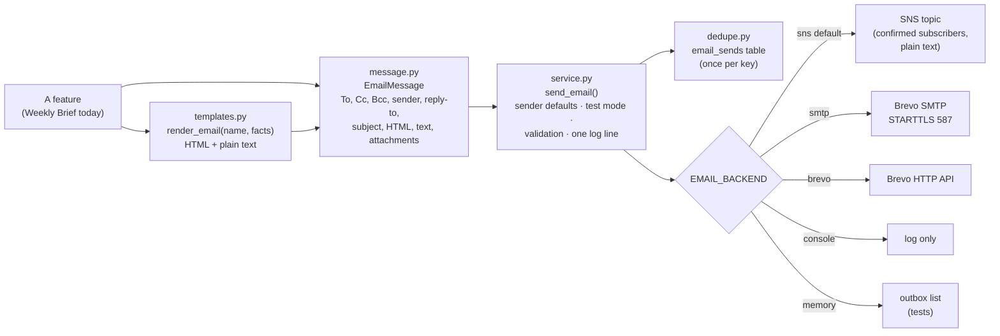
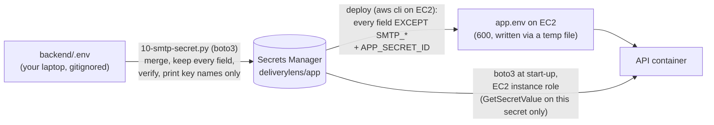

# 9. Email service (`backend/app/email`)

One module sends every email the app sends. A feature builds an `EmailMessage`, renders its body from a
template, and calls `send_email()`. It never talks to SNS, Brevo or SMTP itself.

**Status (Stage 2):** the Weekly Brief uses the module. Production still sends through **Amazon SNS** (the
default). The **`smtp` backend (Brevo SMTP)** and the **`brevo` backend (Brevo HTTP API)** are built and tested
but only used when `EMAIL_BACKEND` selects them. Every Weekly Brief send is recorded in the database, so the same
brief is not sent twice on one day. CloudWatch alarm emails are not part of this module; they stay on their own
SNS topic.

## How it fits together



| File | What it does |
|---|---|
| `message.py` | `EmailMessage` and `Attachment`. Removes duplicate addresses across To, Cc and Bcc. `validate()` rejects empty subjects, line breaks in headers (header injection), bad addresses, unsafe attachment names and attachments over 10 MB. `to_mime()` builds the real email. **Bcc is never written into the headers.** |
| `backends.py` | `SnsBackend` (subject cut to 100 characters, plain-text body, no attachments), **`SmtpBackend`** (below), `BrevoBackend` (Brevo HTTP API), `ConsoleBackend` (logs a summary), `MemoryBackend` (keeps every message, for tests). |
| `service.py` | `send_email()`: picks the backend, fills the sender and reply-to from settings, applies test mode, validates, claims the idempotency key, sends, and logs one JSON line (`email_sent`, `email_failed`, `email_refused` or `email_duplicate_blocked`) with counts and the provider's message id. It never logs addresses, bodies or credentials. A provider failure becomes `EmailDeliveryError`, which carries only the error class and SMTP code and is **not chained** to the provider's exception, so a provider's text (which can echo addresses) never reaches logs or API tracebacks. |
| `dedupe.py` | Duplicate-send protection on the `email_sends` table (below). |
| `templates.py` + `templates/` | Jinja2. `.html` files are autoescaped, so AI or client text cannot inject markup. A missing value fails instead of rendering a blank. `base.html` is the branded layout. `weekly_brief.html` and `.txt` are the brief. |
| `__main__.py` | `python -m app.email check`: connects to the SMTP relay, secures the connection and logs in, then quits. **It never sends.** Prints `{"ok": true, ...}` or the failing stage and error class. |

## The SMTP backend
- **Encrypted only.** `starttls` (port 587): the server must offer STARTTLS, or nothing is sent and the
  credentials are never used. `ssl` (port 465): implicit TLS. The certificate and host name are verified, with
  TLS 1.2 or newer. There is no plain-text fallback.
- **Bcc** addresses are envelope recipients only; the message bytes never contain them.
- **Retries, transient failures only:** network errors, timeouts and 4xx replies (421, 450, 451, 452), at most
  `SMTP_MAX_RETRIES` (2) times, waiting about 1 s then 3 s, within an overall budget of about **40 seconds**, so
  "Send now" answers within the website's 60-second limit.
- **Never retried:** authentication (535), unauthorised IP (525), 5xx replies, all recipients refused, missing
  STARTTLS, certificate errors.
- **Never a duplicate:** once the email's DATA has been sent, a failure without a clear reply means the server
  may have accepted it. That is reported as "outcome unknown" and never retried. An error while closing the
  connection after DATA was accepted counts as sent.
- **Some recipients refused:** the email goes to the rest; the log records how many were refused (no addresses).
- Settings that make no sense fail closed: no host, username or password; a security mode other than
  `starttls`/`ssl`; `starttls` on 465 or `ssl` on 587; retries outside 0–5.

## No duplicate sends (`email_sends` table)
- The Weekly Brief's key is **`weekly_brief:<reporting week>:<send date>`**, the send date in warehouse time
  (`WAREHOUSE_TZ`). The Monday timer and "Send now" share it, so the brief goes out once a day. Next Monday gets
  a new key even though the data's latest week does not change.
- The first sender inserts a row; the database's **unique key** refuses a second one, across processes and
  restarts. Statuses: `sending` → `sent`, `failed` (nothing left the app: retried automatically next time) or
  `unknown` (the provider may have accepted it: blocked until an explicit resend). A `sending` row blocks too.
- **Intentional resend:**
  - on the server: `python -m app.agents.weekly_brief send --resend`;
  - from the API: `POST /api/briefs/weekly/send` with `{"resend": true}`, **only when the server has a
    `DEMO_TOKEN`** (sent as `X-Demo-Token`); otherwise the API answers 403.

  A resend adds a row `<key>:resend:N`. It is refused while another send is still in progress.
- The table stores keys, statuses, counts, the backend, the provider's message id and the error class; no
  addresses and no bodies.
- **Migration:** none to run. The API creates the table at start-up (`create_all`, like every other table) and
  the timer's process creates it if it is missing.

## The Weekly Brief on this module
- **The AI writes only the headline and a 2–3 sentence commentary.** Every table and figure comes from
  `brief_facts()`: KPI tiles, at-risk clients, causes, worst lane, the six-week trend and the actions.
- **The number guardrail still applies to the AI text.** A number that isn't in the facts sends both the
  headline and the commentary back to the rule-written version, and the reason is flagged.
- **Subject:** always rule-written.
- **Formats:** the HTML version is used by backends that can send HTML (`smtp`, `brevo`). SNS sends the
  plain-text version, which ends with a link to the formatted brief on the website (`/weekly-brief?week=...`,
  from `PUBLIC_SITE_URL`). The brief page previews both versions.
- **Sending:**
  - "Send now" (`POST /api/briefs/weekly/send`);
  - the Monday timer (`python -m app.agents.weekly_brief send`; prints `"sent": false` and exits 0 when the
    brief was already sent today).
  - Responses: 409 `already_sent` when it was already sent today; 409 when sending isn't set up; 429 within
    10 minutes of the last send from the same process; 502 `email_not_sent` when the provider refused it (error
    class and code only).

## Configuration

| Variable | Default | Notes |
|---|---|---|
| `EMAIL_BACKEND` | `sns` | `sns`, `smtp` (Brevo SMTP), `brevo` (Brevo HTTP API), `console`, `memory` |
| `WEEKLY_BRIEF_TOPIC_ARN` | – | The SNS backend's topic |
| `EMAIL_FROM_ADDRESS` | – | Sender. **Must be verified and authenticated with the provider.** Not used by SNS. In production, leave it unset and put the sender in the secret as `SMTP_FROM_EMAIL` instead; if both are set, `EMAIL_FROM_ADDRESS` wins. |
| `SMTP_FROM_EMAIL` | – | The sender, read from the secret (`deliverylens/app`) at runtime. Ignored if it is not a valid email address. |
| `EMAIL_FROM_NAME` | `DeliveryLens` | Display name |
| `EMAIL_REPLY_TO` | – | Optional, comma separated |
| `EMAIL_TEST_MODE` | `true` | When on, every email goes only to `EMAIL_TEST_RECIPIENTS`; Cc and Bcc are dropped and the subject starts with `[TEST]`. **With no test recipients, nothing is sent** (no connection is even opened). Applies to `smtp`, `brevo`, `console` and `memory`; not to SNS (the topic always chooses its recipients). |
| `EMAIL_TEST_RECIPIENTS` | – | Comma separated |
| `WEEKLY_BRIEF_TO`, `_CC`, `_BCC` | – | The brief's recipients for backends that address recipients. Never taken from a web request. |
| `SMTP_HOST` | – | `smtp-relay.brevo.com` for Brevo |
| `SMTP_PORT` | `587` | 587 with `starttls`, 465 with `ssl` |
| `SMTP_SECURITY` | `starttls` | `starttls` or `ssl` |
| `SMTP_USERNAME`, `SMTP_PASSWORD` | – | **Secrets** (the Brevo SMTP login and SMTP key). Only in `backend/.env` locally (gitignored) and AWS Secrets Manager (`deliverylens/app`). Never in git, docs or tests. Hidden from logs, `repr` and errors. |
| `APP_SECRET_ID` | – | Production only (the deploy sets it to `deliverylens/app`). The API reads the `SMTP_*` fields from this secret itself (see below). Unset locally and in tests. |
| `APP_SECRET_ACCOUNT` | – | Production only (the deploy sets it from the image's ECR account). The secret must come from this account, from `AWS_REGION`, and have the name `APP_SECRET_ID`, or it is ignored. |
| `SMTP_TIMEOUT_SECONDS` | `15` | Per network operation |
| `SMTP_MAX_RETRIES` | `2` | Transient failures only, within about 40 s |
| `BREVO_API_KEY` | – | **Secret**, for `brevo` (a Brevo API key, not the SMTP key). Only in Secrets Manager. |

**Different recipients per environment.** Each environment sets its own values; none are written in code.

| Environment | Where the values live | Suggested settings |
|---|---|---|
| Development | `backend/.env` (gitignored) | `EMAIL_BACKEND=console` or `memory`, `EMAIL_TEST_MODE=true`, your own address in `EMAIL_TEST_RECIPIENTS` |
| Testing | the test environment's settings | `EMAIL_TEST_MODE=true` and the team's test addresses |
| Production | the `deliverylens/app` secret | `EMAIL_TEST_MODE=false` and the real `WEEKLY_BRIEF_TO`/`_CC`/`_BCC` |

## How the SMTP credentials reach production



- The deploy writes `app.env` from the secret on every deploy, as before, but **leaves out every `SMTP_*`
  field** and adds `APP_SECRET_ID=deliverylens/app`. The file is created owner-only (`umask 077`) through a
  temporary file that is always removed; if the secret cannot be read, the deploy stops and the previous
  `app.env` stays.
- The API reads the `SMTP_*` fields (host, port, security, username, password and the sender
  `SMTP_FROM_EMAIL`) itself with boto3 (`app/runtime_secrets.py`), through the EC2 instance
  role, once per process. It checks that the secret returned is the expected one (name, region and account,
  from `APP_SECRET_ID`, `AWS_REGION` and `APP_SECRET_ACCOUNT`); otherwise it ignores it. They live only in the process's memory: not on disk, not in the environment, not in
  the image or in GitHub. An environment variable with the same name wins (local development).
- If the secret can't be read, the API still starts and logs `runtime_secret_unavailable` with the error code:
  SNS keeps working, and `EMAIL_BACKEND=smtp` fails closed.
- IAM: the EC2 role already has `secretsmanager:GetSecretValue` on `deliverylens/app-*` only; nothing else is
  needed. The GitHub deploy role has no Secrets Manager access and needs none.
- `infra/scripts/05-secrets-rds.sh` now **merges** into the secret, so re-running it keeps the SMTP fields (and
  any other keys) instead of replacing the whole secret. It and `09-weekly-brief.sh` pass secret values through
  owner-only temp files (removed on any exit), never on a command line, and use `python3` (or `python`).

## Switching production to Brevo SMTP (not done yet)
1. **Sender:** a Brevo-verified sender. `@evoketechnologies.com` fails DMARC (`p=reject`, Brevo is not in its
   SPF and it has no Brevo DKIM), so it needs Evoke IT to authorise Brevo first. A personal Gmail sender delivers
   but Brevo flags its DKIM/DMARC, so it may land in Spam. A domain the team controls, with Brevo's SPF and DKIM
   records, is the dependable option.
2. **Brevo → Security → Authorised IPs:** the EC2 address and any office VPN addresses used for testing.
3. **Rotate** the SMTP key in Brevo and put the new one in `backend/.env` (`SMTP_HOST`, `SMTP_PORT`,
   `SMTP_SECURITY`, `SMTP_USERNAME`, `SMTP_PASSWORD`).
4. **Deploy this code first** (so `app.env` stops carrying `SMTP_*`), then merge the SMTP fields into the secret,
   from the repo root (dry run, then apply):
   ```bash
   aws sso login --profile infinity-stacks
   docker run --rm -v ~/.aws:/root/.aws -v "$PWD":/repo:ro -w /repo python:3.11-slim \
     sh -c "pip install -q boto3 && python infra/scripts/10-smtp-secret.py --profile infinity-stacks"
   # same command with --apply at the end to write; it re-reads and verifies, printing key names only
   ```
   Then add `EMAIL_FROM_ADDRESS`, `EMAIL_FROM_NAME`, `EMAIL_TEST_MODE=true` and `EMAIL_TEST_RECIPIENTS` to the
   secret (also a merge, never a replace).
5. **Restart the API** (or deploy again) so it reads the secret, then on the server:
   `docker compose -f docker-compose.prod.yml exec -T api python -m app.email check` (logs in, sends nothing).
6. Set `EMAIL_BACKEND=smtp`, deploy, and send one brief in test mode.
7. When it is right: `EMAIL_TEST_MODE=false` and the real `WEEKLY_BRIEF_TO`/`_CC`/`_BCC`. SNS's double opt-in and
   unsubscribe link go away with SMTP, so the recipient list becomes ours to manage.

## Adding a new email
1. Add `templates/<name>.html` (extend `base.html`) and `templates/<name>.txt`.
2. Render it: `render_email("<name>", context)`.
3. Send it with `send_email(EmailMessage(subject=..., html_body=r.html, text_body=r.text, to=..., category="<name>"),
   idempotency_key="<name>:<what makes it unique>")`. Take recipients from settings (`recipients_for("<name>")`
   reads `<NAME>_TO`/`_CC`/`_BCC` once those settings exist), never from a request.
4. Test it with `EMAIL_BACKEND=memory` (the outbox is `app.email.service.MEMORY.outbox`) and the fake SMTP
   connection in `backend/tests/test_email_smtp.py`.
