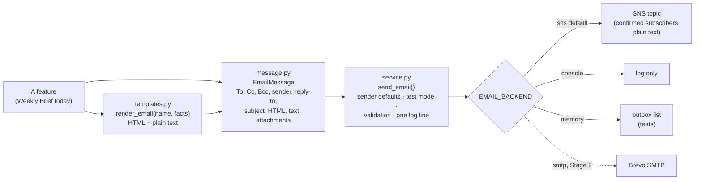

# 9. Email service (`backend/app/email`)

One module sends every email the app sends. A feature builds an `EmailMessage`, renders its body from a
template, and calls `send_email()`. It never talks to SNS or SMTP itself.

**Status (Stage 1):** the module is in place and the Weekly Brief uses it. Delivery is still Amazon SNS, exactly
as before. SMTP (Brevo) is Stage 2 and is not built yet. CloudWatch alarm emails are not part of this module;
they stay on their own SNS topic.

## How it fits together

| File | What it does |
|---|---|
| `message.py` | `EmailMessage` and `Attachment`. Removes duplicate addresses across To, Cc and Bcc. `validate()` rejects empty subjects, line breaks in headers (header injection), bad addresses, unsafe attachment names and attachments over 10 MB. `to_mime()` builds the real email. **Bcc is never written into the headers.** |
| `backends.py` | `SnsBackend` (the same `publish` call as before: subject cut to 100 characters, plain-text body, no attachments), `ConsoleBackend` (logs a summary), `MemoryBackend` (keeps every message, for tests). |
| `service.py` | `send_email()`: picks the backend, fills the sender and reply-to from settings, applies test mode, validates, sends, and logs one JSON line (`email_sent` or `email_failed`) with counts and the provider's message id. It never logs addresses, bodies or credentials. A provider failure becomes `EmailDeliveryError`. Also `recipients_for()`, `missing_recipients()` and `describe()`. |
| `templates.py` + `templates/` | Jinja2. `.html` files are autoescaped, so AI or client text cannot inject markup. A missing value fails instead of rendering a blank. `base.html` is the branded layout. `weekly_brief.html` and `.txt` are the brief. |

## The Weekly Brief on this module
- **The AI writes only the headline and a 2–3 sentence commentary.** Every table and figure comes from
  `brief_facts()`: KPI tiles, at-risk clients, causes, worst lane, the six-week trend and the actions.
- **The number guardrail still applies to the AI text.** A number that isn't in the facts sends both the
  headline and the commentary back to the rule-written version, and the reason is flagged.
- **Subject:** always rule-written.
- **Formats:** the HTML version is used by backends that can send HTML. SNS sends the plain-text version,
  which ends with a link to the formatted brief on the website (`/weekly-brief?week=...`, from `PUBLIC_SITE_URL`).
  The brief page previews both versions.
- **Unchanged:**
  - the manual trigger (`POST /api/briefs/weekly/send`);
  - the Monday timer (`python -m app.agents.weekly_brief send`);
  - the 10-minute cooldown;
  - the 409 when sending isn't set up;
  - with SNS, the recipients (the topic's confirmed subscribers).

## Configuration

| Variable | Default | Notes |
|---|---|---|
| `EMAIL_BACKEND` | `sns` | `sns`, `console`, `memory`, `brevo` (Brevo HTTP API, sends the HTML version). `smtp` is refused until Stage 2. |
| `BREVO_API_KEY` | – | **Secret**, for `brevo`. Only in Secrets Manager. The sender (`EMAIL_FROM_ADDRESS`) must be verified in Brevo; the same sender rules as SMTP below apply. |
| `WEEKLY_BRIEF_TOPIC_ARN` | – | The SNS backend's topic |
| `EMAIL_FROM_ADDRESS` | – | Sender. **Must be verified and authenticated with the provider.** Not used by SNS. |
| `EMAIL_FROM_NAME` | `DeliveryLens` | Display name |
| `EMAIL_REPLY_TO` | – | Optional, comma separated |
| `EMAIL_TEST_MODE` | `true` | When on, every email goes only to `EMAIL_TEST_RECIPIENTS`; Cc and Bcc are dropped and the subject starts with `[TEST]`. With no test recipients, nothing is sent. Not applied to SNS (the topic always chooses its recipients). |
| `EMAIL_TEST_RECIPIENTS` | – | Comma separated |
| `WEEKLY_BRIEF_TO`, `_CC`, `_BCC` | – | The brief's recipients for backends that address recipients. Never taken from a web request. |
| `SMTP_HOST`, `SMTP_PORT` (587), `SMTP_SECURITY` (`starttls` or `ssl`), `SMTP_TIMEOUT_SECONDS` (15), `SMTP_MAX_RETRIES` (3) | | Read now, used in Stage 2 |
| `SMTP_USERNAME`, `SMTP_PASSWORD` | – | **Secrets.** Only in AWS Secrets Manager (`deliverylens/app`). Never in git or `.env.example`. Hidden from logs and `repr`. |

**Different recipients per environment.** Each environment sets its own values; none are written in code.

| Environment | Where the values live | Suggested settings |
|---|---|---|
| Development | `backend/.env` (gitignored) | `EMAIL_BACKEND=console` or `memory`, `EMAIL_TEST_MODE=true`, your own address in `EMAIL_TEST_RECIPIENTS` |
| Testing | the test environment's settings | `EMAIL_TEST_MODE=true` and the team's test addresses |
| Production | the `deliverylens/app` secret | `EMAIL_TEST_MODE=false` and the real `WEEKLY_BRIEF_TO`/`_CC`/`_BCC` (Stage 2) |

The deploy workflow re-reads the secret into the server's `app.env` on every deploy, so new keys reach the API
without other changes.

## Adding a new email
1. Add `templates/<name>.html` (extend `base.html`) and `templates/<name>.txt`.
2. Render it: `render_email("<name>", context)`.
3. Send it with `send_email(EmailMessage(subject=..., html_body=r.html, text_body=r.text, to=..., category="<name>"))`.
   Take recipients from settings (`recipients_for("<name>")` reads `<NAME>_TO`/`_CC`/`_BCC` once those
   settings exist), never from a request.
4. Test it with `EMAIL_BACKEND=memory`. The outbox is `app.email.service.MEMORY.outbox`.

## Before Brevo SMTP (Stage 2): prerequisites
1. **A Brevo account** for the team.
2. **A sender Brevo accepts.**
   - Brevo only sends from senders you have verified.
   - **Don't assume a personal address will work as a sender.** Many mailbox providers publish a strict DMARC
     policy, so mail sent "from" them by Brevo can be rejected or marked as spam.
   - Check each candidate sender in Brevo and send a test before relying on it.
   - The dependable option is a domain the team controls, with Brevo's **SPF and DKIM** records (and a DMARC
     record) added in its DNS.
   - `@evoketechnologies.com` has a DMARC `p=reject` policy, which is why SNS was used. It can only be used after
     Evoke IT authorises Brevo for that domain.
3. **An SMTP key** created in Brevo, plus the SMTP login.
4. **Secrets Manager:** add `SMTP_USERNAME` and `SMTP_PASSWORD` to `deliverylens/app` by merging them in. Don't
   use `infra/scripts/05-secrets-rds.sh` for this; it rewrites the whole secret. Also add `SMTP_HOST`,
   `EMAIL_FROM_ADDRESS`, `EMAIL_FROM_NAME` and the recipient lists. Keep `EMAIL_TEST_MODE=true` with
   `EMAIL_TEST_RECIPIENTS` until the first test sends have been checked.
5. **Network:** the EC2 server must reach the SMTP host on port 587 (outbound). AWS restricts port 25, not 587.
6. **Agreed recipients:** who receives the brief in production. SNS's double opt-in and unsubscribe link go
   away with SMTP, so the recipient list becomes ours to manage.
7. **Stage 2 work:** the SMTP backend (STARTTLS or SSL, timeouts, retries only for temporary errors), a
   database-backed send log that replaces the in-memory cooldown and stops duplicate sends, a local SMTP test
   server (for example Mailpit), and then switching `EMAIL_BACKEND=smtp` in test mode first.
