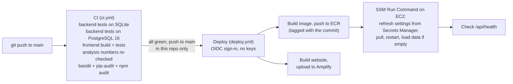

# 13. Environments, deployment and security model

## 1. Three environments, one image, settings from outside the code

The same code and the same Docker image run everywhere. Only the settings change. No setting is hard-coded:
`backend/app/config.py` reads every value from environment variables, with safe defaults.

| | **Dev** (a laptop) | **Test** (CI on every push and pull request) | **Prod** (AWS) |
|---|---|---|---|
| Where | `uvicorn` + `npm run dev`, or `docker compose up` | GitHub Actions `ci.yml` | EC2 (Docker + Caddy), Amplify, RDS |
| Settings come from | `backend/.env` (copy of [`backend/.env.example`](../backend/.env.example), gitignored), `frontend/.env` (copy of [`frontend/.env.example`](../frontend/.env.example)) | The workflow file and `backend/tests/conftest.py` (which never reads a developer's `.env`) | AWS Secrets Manager secret `deliverylens/app`, written to the server's `app.env` (owner-only) by the deploy; Amplify environment variables for the website |
| Database | SQLite file | A throwaway SQLite file, **and** a throwaway PostgreSQL 16 container | RDS PostgreSQL, private, encrypted |
| AI | `mock` (default) or `gemini` with your own key | `mock` | `bedrock` (Claude Haiku and Sonnet) |
| Email | `console` / test mode | `memory` | `sns` |
| Infra settings | n/a | n/a | `infra/config.env` (copy of [`infra/config.env.example`](../infra/config.env.example), gitignored) |

## 2. The pipeline (from scratch, repeatable)

- **From scratch:** `infra/scripts/00-check-access.sh` to `09-weekly-brief.sh` create every AWS resource in order
  (IAM, S3, ECR, network, Secrets Manager + RDS, EC2, first deploy, CloudWatch, weekly brief). Each script checks
  whether its resources exist, so it can be re-run. `99-teardown.sh` deletes everything. Guide: [06](06-aws-setup-guide.md).
- **Every change:** push to `main`; CI, then deploy, run with no human step and no stored secrets.
- **Rollback:** re-run the deploy workflow on an older commit (ECR keeps each commit's image), or use the kept
  `deliverylens-api:pre-cicd` image ([PROJECT-PROGRESS.md section 5](../PROJECT-PROGRESS.md#5-how-to-deploy)).

## 3. Security model

### Who can reach what

| Part | Access | How |
|---|---|---|
| Website (Amplify) | **Login required.** One shared username and password (Amplify basic auth) for the team and the jury | Set in the AWS console; the password is not in the repo |
| API (EC2) | **Open by design for the demo**, HTTPS only | Rate limit on every AI route: 30 requests a minute per IP (`AGENT_RATE_LIMIT_PER_MIN`), answer 429 with Retry-After |
| AI routes, optional lock | `DEMO_TOKEN` set on the server: every POST to an AI route needs the `X-Demo-Token` header (constant-time compare) | Off in the demo; one setting to turn on (test: `test_security.py::test_demo_token_required_on_agent_posts_when_set`) |
| Client address confirmation | A page on the API (`/c/confirm-address/{token}`) with a random token; plain HTML, no script, strict headers | Clients never see the website login |
| Database (RDS) | Not public. Port 5432 open only to the EC2 security group. Encrypted at rest | `infra/scripts/04-network.sh`, `05-secrets-rds.sh` |
| Server | No SSH needed for deploys (SSM Run Command); SSH only from one IP in `ALLOWED_SSH_CIDR` | `infra/scripts/06-ec2.sh` |

### Credentials: where they live

- **No AWS access keys anywhere.** The server uses an IAM instance role; GitHub uses OIDC.
- **App secrets** (database URL, SMTP key) live in **AWS Secrets Manager** (`deliverylens/app`). The server reads them
  at deploy time into an owner-only file, and the API reads the SMTP fields itself with the instance role.
- **Local secrets** (`backend/.env`, `infra/config.env`, `infra/.state/`) are gitignored. The tests refuse to read
  `backend/.env`.
- **Scan:** no real secret in any tracked file ([evidence/security-scan.txt](../evidence/security-scan.txt), 2026-10-29).

### Least privilege (IAM, in `infra/policies/`)

| Role | May do | May not |
|---|---|---|
| `deliverylens-ec2-role` ([ec2-app-policy.json](../infra/policies/ec2-app-policy.json)) | Call Bedrock models; get/put/list in **one** S3 bucket; read **one** secret; pull images; write logs to `/deliverylens/*`; metrics only in the `DeliveryLens` namespace; publish to **one** SNS topic | Delete S3 data, read other secrets, change IAM, anything else |
| `deliverylens-github-deploy` ([github-deploy-policy.json](../infra/policies/github-deploy-policy.json)) | Push to **one** ECR repo; SSM Run Command only on instances tagged with the project; upload to the Amplify app | Anything else. Trusted only for `main` of `Evoke-Hackathon-2026/InfinityStacks` ([github-trust.json](../infra/policies/github-trust.json)) |

### AI safety (inside the product)
- Prompt-injection check before any AI call; input over 20,000 characters refused.
- Personal data hidden in the AI log (`agent_runs`).
- Number guardrail: every number an AI writes must come from the facts it was given.
- Quotes checked by code; the AI cannot add an address or urgency that is not in the client's own text.
- A person approves every order before the WMS and every message before it goes to a client.

### Known gaps (accepted for the demo)
From the [security audit](security/security-audit-2026-10-29.md): the API has no login; one shared website
password; confirmation links do not expire; `/docs` is public; GitHub Actions pinned by tag, not SHA. All are in the
[roadmap](12-scalability-and-roadmap.md#3-roadmap-in-priority-order), item 3.
